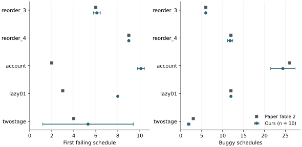
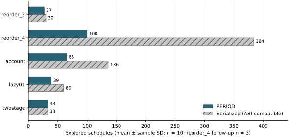
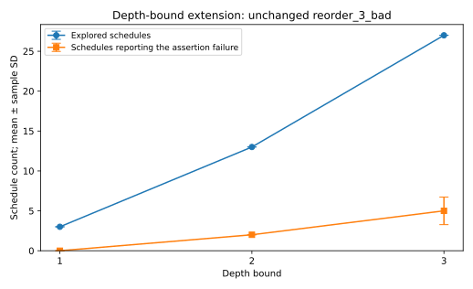

# PERIOD: expanded replication and controlled diagnostics

CS340 Operating Systems · Stage report · 7 November 2026

Confirmed member identities: 孙皓扬 (1240001201), 李扬烁 (1240001156), 何博宇 (1240000576). The fourth member remains to be confirmed. Individual contribution and review status are stated in section 8.

## 1. Scope, claims and principal findings

We reproduce five original Table 2 programs from Wen et al. [1] using the authors' released implementation [2]: reorder_3, reorder_4, account, lazy01 and twostage. The selection covers four program families and different thread counts. It is a purposeful reduced sample, not the complete benchmark suite or a representative random sample of concurrency software.

C1 tests the selected Table 2 schedule counts and failure-discovery results. C2 tests whether the released PERIOD driver explores fewer schedules than the released serialized driver on the same program while still exposing its failure. The serialized driver required a minimal shared-memory compatibility adaptation; its precise label is author_serialized_abi16. Table 2's historical Serial executable is not proven identical to this released, adapted driver. Our original depth-bound study supplies a single-factor extension, and a separate replay-multiplier diagnostic investigates an earlier unexplained miss.

The primary expanded batch attempted 100 comparisons: five cases, two methods and ten repetitions per method. Ninety completed; all ten four-thread serialized invocations were censored by the 120-second outer limit. A separately registered follow-up supplied three complete same-host pairs for that case at a 240-second limit. The matched analysis uses forty complete primary pairs and three follow-up pairs, with no pooling across hosts. Every complete invocation reported a target error. PERIOD reproduces the five paper reference exploration counts; the compatible serialized results are assessed against their separate reference values. PERIOD explores fewer schedules on four cases and the same number on twostage. First-failure positions and buggy-schedule counts show material discrepancies, so the overall replication verdict is **partially reproduced**. Two expanded replay-diagnostic batches each observed 20/20 assertion hits under both multiplier settings, leaving the earlier miss unexplained.

## 2. Experimental setup and registered design

The fixed source revision is cb8deb9a176e5bb292d70d46557dd61dc0e98069. Original benchmark source and inputs are unchanged. The scripts overlay this checkout onto the authors' dependency image, rebuild the static-analysis/instrumentation layer, and build one target binary per case. The image is pinned to sha256:8f47d8b9148f2db579627842026e722d0f205ddeab13e70ee41a8df3dbd59fbc. Installed compiler/SVF dependencies are inherited from that image; we do not claim a fresh source rebuild of every 2022 dependency. Exact commands, versions, original source, license and hashes accompany each case.

The primary batch and four-thread follow-up record Ubuntu 18.04.5 container userland, Clang 10.0.0, GCC 7.5.0, Python 3.6.9 and host kernel 7.0.0-1017-azure. The paper describes Ubuntu 18.04, GCC 7.5, LLVM 10 and a Xeon Silver 4214 workstation [1, section 4.1.3]. Our primary matrix jobs and follow-up used separate hosted machines, shown in Table 1. Both methods within each case and batch used the same host, input and built binary. Container pinning does not pin the host processor or kernel. Earlier pilot and diagnostic batches remain separate host scopes.

**Table 1. Primary expanded-batch and follow-up hardware.** These model strings describe hosts, not shared host identities.

| Case | CPU model reported by host | Affinity |
| --- | --- | --- |
| reorder_3 | AMD EPYC 9V74 80-Core Processor | [0, 1, 2, 3] |
| reorder_4 | AMD EPYC 7763 64-Core Processor | [0, 1, 2, 3] |
| account | AMD EPYC 9V74 80-Core Processor | [0, 1, 2, 3] |
| lazy01 | AMD EPYC 9V45 96-Core Processor | [0, 1, 2, 3] |
| twostage | AMD EPYC 7763 64-Core Processor | [0, 1, 2, 3] |
| reorder_4 follow-up | AMD EPYC 7763 64-Core Processor | [0, 1, 2, 3] |

Each comparison uses depth 3 and a 10,000-schedule budget. Ten serially executed repetition pairs alternate method order AB/BA. The primary outer invocation limit is 120 seconds. All ten four-thread serialized calls reached it; other primary comparisons completed. The separately registered four-thread follow-up uses three paired repetitions and a 240-second outer limit. These six calls completed. No eligible complete call recorded an inner timeout. Fixed-key shared memory makes concurrent invocations within one container inappropriate. Source and binary hashes are captured; generated executables are deliberately not committed, so the archived binary hash is a provenance record rather than a hash that can be recomputed from the archive itself.

The expanded protocol was committed at 6faea36 before its first measurements. Compatibility protocol 7251fb2 followed observation of original-driver failure; 09cfa0a corrected runner method selection before the repeated adapted batch. Adaptation was specified from source/interface evidence, with no tuning to the paper's counts. Earlier attempts are retained: run 42380166815 failed during source loading before benchmark execution; run 42380929383 contains 50 complete PERIOD calls, 50 original serialized-driver crashes and 40 diagnostics; run 42381557337 stopped after one PERIOD call per case due to a runner label error. Run 42381922637 repeats the full predefined sample, including its ten censored outcomes. Follow-up protocol 15ae481 then specified run 42384122902: only reorder_4, three AB/BA/AB pairs, a longer outer watchdog, and unchanged source, program, internal target timeout, depth and schedule budget. The reduced sample meets the course minimum while bounding the additional work. Both methods run again on the follow-up host; its data are not pooled with the primary host.

## 3. Paper versus measured results

All values below are arithmetic mean ± sample standard deviation (denominator n - 1). Table 2 uses ten complete PERIOD invocations per case from the primary batch. Table 3 uses ten complete serialized invocations for four cases and three for reorder_4 from the separate follow-up. The first failing schedule is one-based. Every complete invocation in these tables detected an error, so its first-failure denominator equals the explicitly stated complete sample size. Buggy schedules count failure-producing executions; they do not count distinct defects. Signed delta is our mean minus the paper value; relative delta divides that difference by the paper value. Raw trial-level observations and all descriptive gaps are available in the independent summary.

**Table 2. PERIOD versus the selected rows of paper Table 2; n=10 per case.** Reference values come from PDF page 9 [1].

| Case | Metric | Paper | Ours | Delta | Relative delta |
| --- | --- | ---: | ---: | ---: | ---: |
| reorder_3 | First failing schedule | 6 | 6.100 ± 0.316 | +0.100 | +1.67% |
| reorder_3 | Explored schedules | 27 | 27.000 ± 0.000 | +0.000 | +0.00% |
| reorder_3 | Buggy schedules | 6 | 6.000 ± 0.000 | +0.000 | +0.00% |
| reorder_4 | First failing schedule | 9 | 9.000 ± 0.000 | +0.000 | +0.00% |
| reorder_4 | Explored schedules | 100 | 100.000 ± 0.000 | +0.000 | +0.00% |
| reorder_4 | Buggy schedules | 12 | 11.800 ± 0.632 | -0.200 | -1.67% |
| account | First failing schedule | 2 | 10.100 ± 0.316 | +8.100 | +405.00% |
| account | Explored schedules | 65 | 65.000 ± 0.000 | +0.000 | +0.00% |
| account | Buggy schedules | 26 | 24.400 ± 2.914 | -1.600 | -6.15% |
| lazy01 | First failing schedule | 3 | 8.000 ± 0.000 | +5.000 | +166.67% |
| lazy01 | Explored schedules | 39 | 39.000 ± 0.000 | +0.000 | +0.00% |
| lazy01 | Buggy schedules | 12 | 12.000 ± 0.000 | +0.000 | +0.00% |
| twostage | First failing schedule | 4 | 5.300 ± 4.111 | +1.300 | +32.50% |
| twostage | Explored schedules | 33 | 33.000 ± 0.000 | +0.000 | +0.00% |
| twostage | Buggy schedules | 3 | 1.900 ± 0.316 | -1.100 | -36.67% |

**Table 3. Compatible serialized driver versus paper Serial references; n=10 except reorder_4, n=3 from follow-up 42384122902.** This is a descriptive comparison with the historical reference; the adapter and remaining implementation differences prevent a claim of exact historical executable identity.

| Case | Metric | Paper | Ours | Delta | Relative delta |
| --- | --- | ---: | ---: | ---: | ---: |
| reorder_3 | First failing schedule | 10 | 10.100 ± 0.316 | +0.100 | +1.00% |
| reorder_3 | Explored schedules | 30 | 30.000 ± 0.000 | +0.000 | +0.00% |
| reorder_3 | Buggy schedules | 10 | 9.800 ± 0.919 | -0.200 | -2.00% |
| reorder_4 | First failing schedule | 37 | 47.000 ± 0.000 | +10.000 | +27.03% |
| reorder_4 | Explored schedules | 384 | 384.000 ± 0.000 | +0.000 | +0.00% |
| reorder_4 | Buggy schedules | 90 | 86.333 ± 1.155 | -3.667 | -4.07% |
| account | First failing schedule | 4 | 7.700 ± 7.889 | +3.700 | +92.50% |
| account | Explored schedules | 136 | 136.000 ± 0.000 | +0.000 | +0.00% |
| account | Buggy schedules | 56 | 49.200 ± 8.217 | -6.800 | -12.14% |
| lazy01 | First failing schedule | 4 | 7.200 ± 7.005 | +3.200 | +80.00% |
| lazy01 | Explored schedules | 60 | 60.000 ± 0.000 | +0.000 | +0.00% |
| lazy01 | Buggy schedules | 20 | 17.700 ± 4.715 | -2.300 | -11.50% |
| twostage | First failing schedule | 4 | 4.000 ± 0.000 | +0.000 | +0.00% |
| twostage | Explored schedules | 33 | 33.000 ± 0.000 | +0.000 | +0.00% |
| twostage | Buggy schedules | 3 | 2.200 ± 0.422 | -0.800 | -26.67% |

**Figure 1.** First-failure positions and buggy-schedule counts for PERIOD. Error bars are sample SD, not confidence intervals. The five explored-schedule counts all match the paper exactly and are shown separately in Figure 2.

The PERIOD exploration-count agreement is exact throughout its ten primary repetitions per case. Agreement in that structural quantity does not imply agreement in failure observations. For example, account's first-failure mean is 10.100, versus the paper's 2, a signed gap of +8.100 (+405.00%). Lazy01 first fails at 8.000 versus 3. Twostage produces 1.900 ± 0.316 buggy schedules versus 3. These discrepancies remain in the result tables rather than being hidden by a successful workflow status.

**C1 verdict: partially supported.** Failure detection and explored-schedule counts are supported for the five selected cases; exact first-failure and buggy-count replication is partial. This conclusion concerns the chosen implementation and environments, using the sample sizes and batch scopes stated in Tables 2 and 3.

## 4. Matched comparison and efficiency interpretation

**Table 4. Exploration reduction relative to the compatible serialized driver.** Each count has sample SD zero; n=10 paired repetitions for four cases and n=3 for reorder_4 from follow-up 42384122902. Reductions are computed within each case as (Serial - PERIOD) / Serial.

| Case | PERIOD schedules | Serialized ABI16 schedules | Reduction |
| --- | ---: | ---: | ---: |
| reorder_3 | 27 | 30 | 10.00% |
| reorder_4 | 100 | 384 | 73.96% |
| account | 65 | 136 | 52.21% |
| lazy01 | 39 | 60 | 35.00% |
| twostage | 33 | 33 | 0.00% |

**Figure 2.** Explored schedules for both methods. Each row is a same-host, same-binary comparison; no measurements are pooled across cases. The equality on twostage is an observed result retained alongside the four reductions.

**Table 5. Whole-driver elapsed seconds.** Values and paired differences are mean ± sample SD over ten matched pairs for four cases and three for reorder_4 from the separate follow-up. Positive differences mean the serialized invocation took longer in that case.

| Case | PERIOD seconds | Serialized ABI16 seconds | Paired time difference (Serial - PERIOD) |
| --- | ---: | ---: | ---: |
| reorder_3 | 5.855 ± 0.324 | 9.553 ± 0.827 | 3.698 ± 0.925 |
| reorder_4 | 21.843 ± 0.499 | 133.962 ± 2.705 | 112.119 ± 2.913 |
| account | 23.738 ± 2.356 | 49.317 ± 7.662 | 25.579 ± 8.536 |
| lazy01 | 11.485 ± 0.434 | 16.888 ± 4.119 | 5.403 ± 3.853 |
| twostage | 2.664 ± 0.296 | 2.652 ± 0.378 | -0.011 ± 0.439 |

Elapsed time includes calibration, target execution, detection, reporting and driver overhead. The two released drivers retain differences in dry-run handling, small-period scaling, default schedules and exploration logic. The ABI adaptation resolves the segment-size and element-width incompatibility that prevented the released serialized driver from running. The remaining location/order-array offset mismatch and other driver differences are retained. We therefore use schedule counts as the main structural comparison and report wall time as a secondary implementation-level observation. No pooled cross-host speedup, native-program speedup, or paper-workstation speedup is inferred.

**C2 verdict: supported within the stated comparison.** PERIOD explored fewer schedules in four of five cases while both methods detected the target error in every complete repetition; twostage tied. The result supports a local search-reduction observation against the adapted released serialized implementation. It does not reproduce the paper's comparisons against every other tool, establish superiority for arbitrary programs, or establish historical binary identity.

The first-error position does not favour PERIOD uniformly. In the primary batch, account averages 10.1 for PERIOD versus 7.7 for the compatible serialized driver; lazy01 averages 8.0 versus 7.2; twostage averages 5.3 versus 4.0. A smaller final exploration space and an earlier first observed error are different properties. The supported claim here is the stated search-volume comparison, with failure discovery retained.

## 5. Discrepancy analysis and controlled checks

### 5.1 Original serialized-driver failure and the scoped repair

All 50 original serialized invocations in run 42380929383 exited with signal 11 before schedule enumeration. Their missing metrics remain missing. The original driver requests a 24,300-byte System V shared-memory segment using 32-bit arrays; the current C runtime uses 16-bit arrays with an ordinary x86-64 structure size of 24,008 bytes. The current PERIOD driver requests 12,160 bytes. Source inspection shows unchecked shmget/shmat results before memory copying.

Because the runtime had already created the smaller segment at key 1111, the old driver's larger request could fail before the unchecked attachment was copied. A fresh isolated IPC mechanism probe reproduced the predicted size rejection. More directly, the completed compatible jobs queried their actual runtime key 1111: the current-size request succeeded, the original-size request returned -1 with errno 22, and an invalid attach produced the failure sentinel. Together with the pre-enumeration crashes and successful adapted execution, this strongly supports the identified interface incompatibility. The isolated probe is not a benchmark repetition and is reported separately.

The adaptation copies only three IPC helper functions and changes four array element types to those of the pinned current PERIOD driver. It leaves the original serialized enumeration section byte-identical. Each case archives the exact diff, original/adapted source and SHA-256 values. This is why the comparator is explicitly labelled author_serialized_abi16. The adapted serialized driver and the current PERIOD driver retain a separate 1,990-versus-3,964 array-capacity mismatch relative to the C runtime: their yield-array starts agree with the runtime, but their location/order offsets do not. We preserve and disclose this residual limitation instead of treating the minimal adapter as a complete runtime repair.

An evidence-collection defect also affected the original failed-driver batch: a failed invocation could inherit a previously created PERIOD witness directory. Those historical files remain unchanged, are explicitly excluded from serialized attribution, and are never used to count bugs. The corrected collector accepts only newly created output directories; regression tests cover the failure path. Primary statistics are independently reconstructed from each invocation's own hashed log.

### 5.2 Censoring and the predeclared completion check

The primary four-thread serialized calls each reached the 120-second outer limit. All had already reported their first error at printed schedule 47, and they stopped after 272–276 printed schedules with 61–62 error events. Those are observed prefixes: the final search total and full-driver completion time are missing. A censored run is not evidence that no failure was found, and 120 seconds is not its exact completion time. The independent summary preserves these prefix observations separately from complete-run statistics.

The follow-up increases the outer observation window to 240 seconds, keeps the original internal method settings and workload, and fixes three pairs before execution. Its six complete calls provide the four-thread paired observations used in Tables 3–5. The new host and smaller sample remain explicit; the follow-up does not erase the ten original censored runs or estimate a causal speedup from the watchdog change.

### 5.3 Enumeration consistency and observed failure variability

For each complete case-method condition, the ordered sequence of printed schedule descriptions was identical within its own batch: nine primary conditions with ten complete repetitions each, plus two follow-up conditions with three complete repetitions each. Censored serialized prefixes are excluded from this full-sequence check. A separate SHA-256 sequence audit records this check. Some first-error and buggy-count observations still vary. A change in printed enumeration cannot fully explain that within-condition variation. Printed requested schedules are not a measured trace of realized memory-operation order, and the mismatched location/order arrays cannot be used as if they decoded that trace correctly. The current evidence does not identify one causal explanation for all failure-count gaps.

### 5.4 Replay-multiplier sensitivity diagnostic

The original follow-up observed the expected assertion in 4/5 replays of the fixed reorder_3 witness [[0,2],[2,0],[1,0]]. The first replay had no expected assertion and did not reach the outer timeout. Its outer driver exit code was zero. That result is retained.

Each later diagnostic batch uses the same fixed witness and built binary within its own host scope, twenty repetitions at multiplier 1.5 and twenty at 6.0, alternating AB/BA. A diagnostic copy changes the multiplier and prints the target return code and measured calibration after execution. The benchmark binary is unchanged. Every invocation recalibrates as the original driver does: fourfold multiplier is not a guarantee of fourfold realized kernel deadline because calibration and piecewise runtime conversion vary.

**Table 6. Replay observations, kept separate by batch.**

| Batch | Multiplier 1.5 | Multiplier 6.0 | Interpretation |
| --- | --- | --- | --- |
| Original follow-up | 4/5 expected assertions | Not run | One recorded miss |
| 42380929383 | 20/20; target -6 | 20/20; target -6 | No observed setting difference |
| 42381922637 | 20/20; target -6 | 20/20; target -6 | No observed setting difference |

The diagnostic outcome is **inconclusive for the cause of the earlier miss**. Both new batches reached a ceiling of all observed hits. This supplies no observed setting effect and does not establish equal underlying probabilities or deterministic replay. We do not replace the original 4/5 observation with a pooled success rate. Same-host consecutive repetitions can be dependent; descriptive counts are the primary evidence. A future causal test would require a correctly decoded parent-only trace and a separately registered timing intervention. That test has not been performed here.

## 6. Single-factor depth-bound extension

The original follow-up remains a separate controlled extension. On one reorder_3 binary and host it varied only the requested depth bound among 1, 2 and 3, with balanced repetition orders (1,2,3), (3,1,2), (2,3,1), the same input and budget, and three repetitions per condition. Bounds 1 and 2 extend the paper's selected depth-3 configuration. These observations are not combined with the expanded batch's timings.

**Table 7. Depth-bound extension, mean ± sample SD, n=3.**

| Bound | Explored schedules | Buggy schedules | Runs detecting failure | First failing schedule | Whole-driver seconds |
| ---: | ---: | ---: | ---: | ---: | ---: |
| 1 | 3.000 ± 0.000 | 0.000 ± 0.000 | 0/3 | Not observed | 0.371 ± 0.092 |
| 2 | 13.000 ± 0.000 | 2.000 ± 0.000 | 3/3 | 6.000 ± 0.000 | 2.877 ± 0.198 |
| 3 | 27.000 ± 0.000 | 5.000 ± 1.732 | 3/3 | 6.000 ± 0.000 | 6.459 ± 1.975 |

**Figure 3.** Earlier single-factor depth study with sample SD. Connected discrete bounds do not imply measurements at intermediate settings.

Depth 2 found the known failure in all three repetitions with 51.85% fewer explored schedules than depth 3. Depth 3 exposed additional failing schedules. The observation illustrates a local coverage/work trade-off: depth 2 detected this particular defect while exploring fewer requested schedules and using less whole-driver time than depth 3. Time to the first failure was not measured separately. Depth 1's no-failure outcome establishes only what was observed within that bound; it does not establish program correctness. This extension is motivated by the search-reduction question and has a bounded, reproducible result.

## 7. Evidence, verification and dated progress

The primary archive is results/2026-11-07/comparison-42381922637; the four-thread follow-up is comparison-42384122902. Their summaries preserve separate denominators and host scopes. Every case has records.json, raw command logs, source, environment, image/compiler metadata, the compatibility diff, IPC probe and a per-case manifest. The outer archive_manifest.json protects all retained artifact bytes. The independent summarizer verifies those hashes and driver-source hashes, reads commands and runner footers from the logs, recounts sequential test/error/timeout events, checks the registered AB/BA order and actual denominators, and preserves incomplete attempts separately. Its JSON and CSV outputs are under summaries/comparison-42381922637; the original failed comparison has its own summary directory.

The independent audit imports no parser from the measurement runner. Unit-test data are explicitly synthetic and never enter measured summaries. First-failure values remain missing when no target error is observed. The two primary source/measurement streams and their bounded failure witnesses are retained with their upstream license; instructor material and compiled outputs are not redistributed. Reproduction instructions, expected outputs and runtime limits are in README.md; make audit and make summarize regenerate the checks and descriptive summaries. The report and figures can be regenerated from their maintained source and audited data.

The original pilot/follow-up comprises 33 test/replay invocations, six builds and one capability probe. The latter successfully requested SCHED_DEADLINE in that earlier environment; it is not proof about every instruction of later execution. Expanded comparisons, diagnostics, setup failures and partial attempts are reported separately above. Logs and actual commit dates preserve this chronology.

The dated progress record separates initial repository preparation on 24 October, substantive safeguard/test work on 30 October, and the measured PERIOD studies on 7 November. Nothing is backdated to fill a previous week. Weekly progress continues beyond this stage; the supplied course document sets Sunday 23:59 checks but does not explicitly identify the timezone or first calendar check. Group planning uses Macau/Beijing local time and an earlier internal cutoff [3].

## 8. Conclusion, limitations and contributions

**Overall verdict:** PERIOD is partially reproduced in this five-case, bounded comparison.

The study is limited by purposeful five-case coverage, hosted hardware differences, preserved upstream driver differences, the residual shared-memory layout mismatch, repeated observations on one host per case, a three-pair follow-up for the most expensive case, and unresolved causes of some failure variability. The main comparison supports a structural reduction against one explicitly adapted released baseline. It does not establish the full paper's broader effectiveness or runtime claims. Historical partial results, original crashes and replay exceptions remain visible.

The owner confirmed the selected paper, supplied group identities, requested the work and authorized repository publication. The usage statement records the assistance involved in implementation, execution, auditing and drafting. Individual implementation, clean-environment reruns and human review are not assigned to another student without evidence. The known member roster and actual contribution record are maintained in docs/TEAM.csv and docs/CONTRIBUTIONS.csv; a fourth member and two GitHub handles remain to be confirmed.

The next high-value step is a different member's clean-environment rerun followed by an independent table-to-log audit and oral explanation of the mechanisms and limitations. A separate Chinese member checklist assigns suggested tasks, commands and evidence requirements; it is not a record of completed personal contributions. The registration receipt, final submission date and separate presentation rubric still require course-platform verification. This document is an expanded stage report, with final English PDF submission and v1.0 tagging reserved for the actual final version.

## References

[1] Wen, C., He, M., Wu, B., Xu, Z. and Qin, S. Controlled Concurrency Testing via Periodical Scheduling. ICSE 2022. DOI: 10.1145/3510003.3510178. Table 2, PDF p. 9; experiment settings, section 4.1.3.
https://wcventure.github.io/pdf/ICSE2022_PERIOD.pdf

[2] Authors' implementation, source revision cb8deb9a176e5bb292d70d46557dd61dc0e98069.
https://github.com/wcventure/PERIOD

[3] Instructor-provided CS340 Research Paper Replication, Academic Year 2026–2027, pp. 1–4. Course source retained by the students; not redistributed in this repository.

[4] Registered protocols and exact study archives in the project repository. Main comparison workflow: https://github.com/Sasuke-666/CS340-Research-Paper-Replication/actions/runs/42381922637
