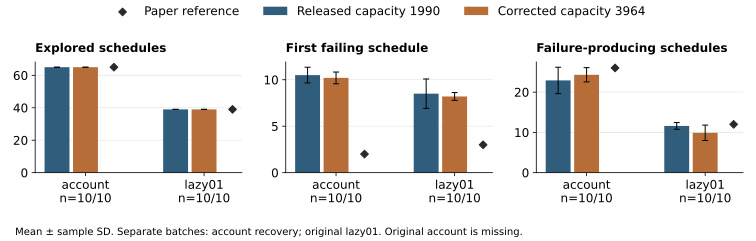

# PERIOD Replication and Controlled Diagnostics

CS340 Operating Systems · Stage report revised 14 November 2026. Original measurements retain their actual 7 and 8 November dates; the third-week diagnostic is a separate study.

Confirmed member identities: 孙皓扬 (1240001201), 李扬烁 (1240001156), 何博宇 (1240000576). The fourth member remains to be confirmed. Individual contribution and review status are stated in section 10.

## 1. Scope, claims and principal findings

We reproduce five original Table 2 programs from Wen et al. [1] using the authors' released implementation [2]: reorder_3, reorder_4, account, lazy01 and twostage. This purposeful reduced sample covers four program families and different thread counts. Its conclusions apply to the selected programs and declared environments.

Concurrency failures depend on the order in which threads access shared state. PERIOD assigns key operations to successive execution periods; operations in a later period wait for earlier periods to finish. Its implementation allows remaining operations from different threads to share the final period. A generator explores schedules within a period bound, while execution feedback identifies additional dynamic key-point slices and guides subsequent exploration [1, sections 2.2 and 3]. This mechanism motivates our two measurements: the amount of requested scheduling work and the failures actually observed. A smaller requested search does not by itself establish earlier failure discovery or reliable replay.

C1 tests the selected Table 2 schedule counts and failure-discovery results. C2 tests whether the released PERIOD driver explores fewer schedules than the released serialized driver on the same program while still exposing its failure. The serialized driver required a minimal shared-memory compatibility adaptation; its precise label is author_serialized_abi16. Table 2's historical Serial executable is not proven identical to this released, adapted driver. Our original depth-bound study supplies a single-factor extension, and a separate replay-multiplier diagnostic investigates an earlier unexplained miss.

The primary expanded batch attempted 100 comparisons: five cases, two methods and ten repetitions per method. Ninety completed; all ten four-thread serialized invocations were censored by the 120-second outer limit. A separately registered follow-up supplied three complete same-host pairs for that case at a 240-second limit. The matched analysis uses forty complete primary pairs and three follow-up pairs, with no pooling across hosts. Every complete invocation reported a target error. PERIOD reproduces the five paper reference exploration counts; the compatible serialized results are assessed against their separate reference values. PERIOD explores fewer schedules on four cases and the same number on twostage. First-failure positions and buggy-schedule counts show material discrepancies, so the overall replication verdict is **partially reproduced**. Two expanded replay-diagnostic batches each observed 20/20 assertion hits under both multiplier settings, leaving the earlier miss unexplained.

The 14 November capacity diagnostic adds forty readable calls across separately scoped account and lazy01 batches. A compiled native-layout check verifies the corrected field offsets. The intervention changes actual feedback hashes while leaving both requested exploration sequences unchanged. Corrected first-failure means remain 10.200 for account versus the paper's 2, and 8.200 for lazy01 versus 3. Timing and failure-yield changes have mixed directions. The original account job's unreadable evidence remains explicitly missing; a newly registered recovery supplies the separate account batch used here.

## 2. Experimental setup and registered design

The fixed source revision is cb8deb9a176e5bb292d70d46557dd61dc0e98069. Original benchmark source and inputs are unchanged. The scripts overlay this checkout onto the authors' dependency image, rebuild the static-analysis/instrumentation layer, and build one target binary per case. The image is pinned to sha256:8f47d8b9148f2db579627842026e722d0f205ddeab13e70ee41a8df3dbd59fbc. Installed compiler/SVF dependencies are inherited from that image; we do not claim a fresh source rebuild of every 2022 dependency. Exact commands, versions, original source, license and hashes accompany each case.

Appendix A places the consequential setup deviations inside this report. The maintained CSV supplies the same settings with additional archive references. Source modifications are limited and separately labelled: the serialized IPC adapter, replay diagnostic instrumentation, and the capacity-only driver copy used in the third-week study. Benchmark and native runtime source remain unchanged.

The primary batch and four-thread follow-up record Ubuntu 18.04.5 container userland, Clang 10.0.0, GCC 7.5.0, Python 3.6.9 and host kernel 7.0.0-1017-azure. The paper describes Ubuntu 18.04, GCC 7.5, LLVM 10 and a Xeon Silver 4214 workstation [1, section 4.1.3]. Our primary matrix jobs and follow-up used separate hosted machines, shown in Table 1. Both methods within each case and batch used the same host, input and built binary. Container pinning does not pin the host processor or kernel. Earlier pilot and diagnostic batches remain separate host scopes.

**Table 1. Primary expanded-batch and follow-up hardware.** These model strings describe hosts, not shared host identities.

| Case | CPU model reported by host | Affinity |
| --- | --- | --- |
| reorder_3 | AMD EPYC 9V74 80-Core Processor | [0, 1, 2, 3] |
| reorder_4 | AMD EPYC 7763 64-Core Processor | [0, 1, 2, 3] |
| account | AMD EPYC 9V74 80-Core Processor | [0, 1, 2, 3] |
| lazy01 | AMD EPYC 9V45 96-Core Processor | [0, 1, 2, 3] |
| twostage | AMD EPYC 7763 64-Core Processor | [0, 1, 2, 3] |
| reorder_4 follow-up | AMD EPYC 7763 64-Core Processor | [0, 1, 2, 3] |

Each comparison uses depth 3 and a 10,000-schedule budget. Ten serially executed repetition pairs alternate method order AB/BA. The primary outer invocation limit is 120 seconds. All ten four-thread serialized calls reached it; other primary comparisons completed. The separately registered four-thread follow-up uses three paired repetitions and a 240-second outer limit. These six calls completed. No eligible complete call recorded an inner timeout. Fixed-key shared memory makes concurrent invocations within one container inappropriate. Source and binary hashes are captured; generated executables are deliberately not committed, so the archived binary hash is a provenance record rather than a hash that can be recomputed from the archive itself.

The expanded protocol was committed at 6faea36 before its first measurements. Compatibility protocol 7251fb2 followed observation of original-driver failure; 09cfa0a corrected runner method selection before the repeated adapted batch. Adaptation was specified from source/interface evidence, with no tuning to the paper's counts. Earlier attempts are retained: run 42380166815 failed during source loading before benchmark execution; run 42380929383 contains 50 complete PERIOD calls, 50 original serialized-driver crashes and 40 diagnostics; run 42381557337 stopped after one PERIOD call per case due to a runner label error. Run 42381922637 repeats the full predefined sample, including its ten censored outcomes. Follow-up protocol 15ae481 then specified run 42384122902: only reorder_4, three AB/BA/AB pairs, a longer outer watchdog, and unchanged source, program, internal target timeout, depth and schedule budget. The reduced sample meets the course minimum while bounding the additional work. Both methods run again on the follow-up host; its data are not pooled with the primary host.

## 3. Paper versus measured results

All values below are arithmetic mean ± sample standard deviation (denominator n - 1). Table 2 uses ten complete PERIOD invocations per case from the primary batch. Table 3 uses ten complete serialized invocations for four cases and three for reorder_4 from the separate follow-up. The first failing schedule is one-based. Every complete invocation in these tables detected an error, so its first-failure denominator equals the explicitly stated complete sample size. Buggy schedules count failure-producing executions; they do not count distinct defects. Signed delta is our mean minus the paper value; relative delta divides that difference by the paper value. Raw trial-level observations and all descriptive gaps are available in the independent summary.

**Table 2. PERIOD versus the selected rows of paper Table 2; n=10 per case.** Reference values come from PDF page 9 [1].

| Case | Metric | Paper | Ours | Delta | Relative delta |
| --- | --- | ---: | ---: | ---: | ---: |
| reorder_3 | First failing schedule | 6 | 6.100 ± 0.316 | +0.100 | +1.67% |
| reorder_3 | Explored schedules | 27 | 27.000 ± 0.000 | +0.000 | +0.00% |
| reorder_3 | Buggy schedules | 6 | 6.000 ± 0.000 | +0.000 | +0.00% |
| reorder_4 | First failing schedule | 9 | 9.000 ± 0.000 | +0.000 | +0.00% |
| reorder_4 | Explored schedules | 100 | 100.000 ± 0.000 | +0.000 | +0.00% |
| reorder_4 | Buggy schedules | 12 | 11.800 ± 0.632 | -0.200 | -1.67% |
| account | First failing schedule | 2 | 10.100 ± 0.316 | +8.100 | +405.00% |
| account | Explored schedules | 65 | 65.000 ± 0.000 | +0.000 | +0.00% |
| account | Buggy schedules | 26 | 24.400 ± 2.914 | -1.600 | -6.15% |
| lazy01 | First failing schedule | 3 | 8.000 ± 0.000 | +5.000 | +166.67% |
| lazy01 | Explored schedules | 39 | 39.000 ± 0.000 | +0.000 | +0.00% |
| lazy01 | Buggy schedules | 12 | 12.000 ± 0.000 | +0.000 | +0.00% |
| twostage | First failing schedule | 4 | 5.300 ± 4.111 | +1.300 | +32.50% |
| twostage | Explored schedules | 33 | 33.000 ± 0.000 | +0.000 | +0.00% |
| twostage | Buggy schedules | 3 | 1.900 ± 0.316 | -1.100 | -36.67% |

**Table 3. Compatible serialized driver versus paper Serial references; n=10 except reorder_4, n=3 from follow-up 42384122902.** This is a descriptive comparison with the historical reference; the adapter and remaining implementation differences prevent a claim of exact historical executable identity.

| Case | Metric | Paper | Ours | Delta | Relative delta |
| --- | --- | ---: | ---: | ---: | ---: |
| reorder_3 | First failing schedule | 10 | 10.100 ± 0.316 | +0.100 | +1.00% |
| reorder_3 | Explored schedules | 30 | 30.000 ± 0.000 | +0.000 | +0.00% |
| reorder_3 | Buggy schedules | 10 | 9.800 ± 0.919 | -0.200 | -2.00% |
| reorder_4 | First failing schedule | 37 | 47.000 ± 0.000 | +10.000 | +27.03% |
| reorder_4 | Explored schedules | 384 | 384.000 ± 0.000 | +0.000 | +0.00% |
| reorder_4 | Buggy schedules | 90 | 86.333 ± 1.155 | -3.667 | -4.07% |
| account | First failing schedule | 4 | 7.700 ± 7.889 | +3.700 | +92.50% |
| account | Explored schedules | 136 | 136.000 ± 0.000 | +0.000 | +0.00% |
| account | Buggy schedules | 56 | 49.200 ± 8.217 | -6.800 | -12.14% |
| lazy01 | First failing schedule | 4 | 7.200 ± 7.005 | +3.200 | +80.00% |
| lazy01 | Explored schedules | 60 | 60.000 ± 0.000 | +0.000 | +0.00% |
| lazy01 | Buggy schedules | 20 | 17.700 ± 4.715 | -2.300 | -11.50% |
| twostage | First failing schedule | 4 | 4.000 ± 0.000 | +0.000 | +0.00% |
| twostage | Explored schedules | 33 | 33.000 ± 0.000 | +0.000 | +0.00% |
| twostage | Buggy schedules | 3 | 2.200 ± 0.422 | -0.800 | -26.67% |

**Figure 1.** First-failure positions and buggy-schedule counts for PERIOD. Error bars are sample SD, not confidence intervals. The five explored-schedule counts all match the paper exactly and are shown separately in Figure 2.

The PERIOD exploration-count agreement is exact throughout its ten primary repetitions per case. Failure observations show separate discrepancies: account's first-failure mean is 10.100, versus the paper's 2, a signed gap of +8.100 (+405.00%); lazy01 first fails at 8.000 versus 3; twostage produces 1.900 ± 0.316 buggy schedules versus 3. These quantities establish which parts of the paper's result were reproduced.

**C1 verdict: partially supported.** Failure detection and explored-schedule counts are supported for the five selected cases; exact first-failure and buggy-count replication is partial. This conclusion concerns the chosen implementation and environments, using the sample sizes and batch scopes stated in Tables 2 and 3.

## 4. Matched comparison and efficiency interpretation

**Table 4. Exploration reduction relative to the compatible serialized driver.** Each count has sample SD zero; n=10 paired repetitions for four cases and n=3 for reorder_4 from follow-up 42384122902. Reductions are computed within each case as (Serial - PERIOD) / Serial.

| Case | PERIOD schedules | Serialized ABI16 schedules | Reduction |
| --- | ---: | ---: | ---: |
| reorder_3 | 27 | 30 | 10.00% |
| reorder_4 | 100 | 384 | 73.96% |
| account | 65 | 136 | 52.21% |
| lazy01 | 39 | 60 | 35.00% |
| twostage | 33 | 33 | 0.00% |

**Figure 2.** Explored schedules for both methods. Each row is a same-host, same-binary comparison; no measurements are pooled across cases. The equality on twostage is an observed result retained alongside the four reductions.

**Table 5. Whole-driver elapsed seconds.** Values and paired differences are mean ± sample SD over ten matched pairs for four cases and three for reorder_4 from the separate follow-up. Positive differences mean the serialized invocation took longer in that case.

| Case | PERIOD seconds | Serialized ABI16 seconds | Paired time difference (Serial - PERIOD) |
| --- | ---: | ---: | ---: |
| reorder_3 | 5.855 ± 0.324 | 9.553 ± 0.827 | 3.698 ± 0.925 |
| reorder_4 | 21.843 ± 0.499 | 133.962 ± 2.705 | 112.119 ± 2.913 |
| account | 23.738 ± 2.356 | 49.317 ± 7.662 | 25.579 ± 8.536 |
| lazy01 | 11.485 ± 0.434 | 16.888 ± 4.119 | 5.403 ± 3.853 |
| twostage | 2.664 ± 0.296 | 2.652 ± 0.378 | -0.011 ± 0.439 |

Elapsed time includes calibration, target execution, detection, reporting and driver overhead. The two released drivers retain differences in dry-run handling, small-period scaling, default schedules and exploration logic. The ABI adaptation resolves the segment-size and element-width incompatibility that prevented the released serialized driver from running. The remaining location/order-array offset mismatch and other driver differences are retained. We therefore use schedule counts as the main structural comparison and report wall time as a secondary implementation-level observation. No pooled cross-host speedup, native-program speedup, or paper-workstation speedup is inferred.

**C2 verdict: supported within the stated comparison.** PERIOD explored fewer schedules in four of five cases while both methods detected the target error in every complete repetition; twostage tied. The result supports a local search-reduction observation against the adapted released serialized implementation. It does not reproduce the paper's comparisons against every other tool, establish superiority for arbitrary programs, or establish historical binary identity.

The first-error position does not favour PERIOD uniformly. In the primary batch, account averages 10.1 for PERIOD versus 7.7 for the compatible serialized driver; lazy01 averages 8.0 versus 7.2; twostage averages 5.3 versus 4.0. A smaller final exploration space and an earlier first observed error are different properties. The supported claim here is the stated search-volume comparison, with failure discovery retained.

## 5. Discrepancy analysis and controlled checks

### 5.1 Original serialized-driver failure and the scoped repair

All 50 original serialized invocations in run 42380929383 exited with signal 11 before schedule enumeration. Their missing metrics remain missing. The original driver requests a 24,300-byte System V shared-memory segment using 32-bit arrays; the current C runtime uses 16-bit arrays with an ordinary x86-64 structure size of 24,008 bytes. The current PERIOD driver requests 12,160 bytes. Source inspection shows unchecked shmget/shmat results before memory copying.

Because the runtime had already created the smaller segment at key 1111, the old driver's larger request could fail before the unchecked attachment was copied. A fresh isolated IPC mechanism probe reproduced the predicted size rejection. More directly, the completed compatible jobs queried their actual runtime key 1111: the current-size request succeeded, the original-size request returned -1 with errno 22, and an invalid attach produced the failure sentinel. Together with the pre-enumeration crashes and successful adapted execution, this strongly supports the identified interface incompatibility. The isolated probe is not a benchmark repetition and is reported separately.

The adaptation copies only three IPC helper functions and changes four array element types to those of the pinned current PERIOD driver. It leaves the original serialized enumeration section byte-identical. Each case archives the exact diff, original/adapted source and SHA-256 values. This is why the comparator is explicitly labelled author_serialized_abi16. The adapted serialized driver and the current PERIOD driver retain a separate 1,990-versus-3,964 array-capacity mismatch relative to the C runtime: their yield-array starts agree with the runtime, but their location/order offsets do not. The historical comparisons preserve this residual limitation. Section 8 separately tests one capacity correction in the PERIOD driver under a newly registered, controlled design.

An evidence-collection defect also affected the original failed-driver batch: a failed invocation could inherit a previously created PERIOD witness directory. Those historical files remain unchanged, are explicitly excluded from serialized attribution, and are never used to count bugs. The corrected collector accepts only newly created output directories; regression tests cover the failure path. Primary statistics are independently reconstructed from each invocation's own hashed log.

### 5.2 Censoring and the predeclared completion check

The primary four-thread serialized calls each reached the 120-second outer limit. All had already reported their first error at printed schedule 47, and they stopped after 272–276 printed schedules with 61–62 error events. These are observed prefixes containing detected failures. The final search total and full-driver completion time remain missing. The independent summary preserves prefix observations separately from complete-run statistics.

The follow-up increases the outer observation window to 240 seconds, keeps the original internal method settings and workload, and fixes three pairs before execution. Its six complete calls provide the four-thread paired observations used in Tables 3–5. The new host and smaller sample remain explicit; the follow-up does not erase the ten original censored runs or estimate a causal speedup from the watchdog change.

### 5.3 Enumeration consistency and observed failure variability

For each complete case-method condition, the ordered sequence of printed schedule descriptions was identical within its own batch: nine primary conditions with ten complete repetitions each, plus two follow-up conditions with three complete repetitions each. A separate SHA-256 sequence audit verifies these complete sequences; censored prefixes retain their separate status. First-error and buggy-count observations still vary under unchanged requested sequences. This narrows the explanation toward realized execution and feedback behavior. Establishing the actual memory-operation order would require a separately validated execution trace; the historical location/order arrays have the offset mismatch described above.

### 5.4 Replay-multiplier sensitivity diagnostic

The original follow-up observed the expected assertion in 4/5 replays of the fixed reorder_3 witness [[0,2],[2,0],[1,0]]. The first replay had no expected assertion and did not reach the outer timeout. Its outer driver exit code was zero. That result is retained.

Each later diagnostic batch uses the same fixed witness and built binary within its own host scope, twenty repetitions at multiplier 1.5 and twenty at 6.0, alternating AB/BA. A diagnostic copy changes the multiplier and prints the target return code and measured calibration after execution. The benchmark binary is unchanged. Every invocation recalibrates as the original driver does: fourfold multiplier is not a guarantee of fourfold realized kernel deadline because calibration and piecewise runtime conversion vary.

**Table 6. Replay observations, kept separate by batch.**

| Batch | Multiplier 1.5 | Multiplier 6.0 | Interpretation |
| --- | --- | --- | --- |
| Original follow-up | 4/5 expected assertions | Not run | One recorded miss |
| 42380929383 | 20/20; target -6 | 20/20; target -6 | No observed setting difference |
| 42381922637 | 20/20; target -6 | 20/20; target -6 | No observed setting difference |

The diagnostic outcome is **inconclusive for the cause of the earlier miss**. Both new batches reached a ceiling of all observed hits, leaving the setting effect unresolved. The original 4/5 observation and the two later batches retain their separate denominators. Same-host consecutive repetitions can be dependent, so the evidence is descriptive. A causal test of the timing explanation would require a correctly decoded parent-only trace and a separately registered timing intervention.

## 6. Single-factor depth-bound extension

The original follow-up remains a separate controlled extension. On one reorder_3 binary and host it varied only the requested depth bound among 1, 2 and 3, with balanced repetition orders (1,2,3), (3,1,2), (2,3,1), the same input and budget, and three repetitions per condition. Bounds 1 and 2 extend the paper's selected depth-3 configuration. These observations are not combined with the expanded batch's timings.

**Table 7. Depth-bound extension, mean ± sample SD, n=3.**

| Bound | Explored schedules | Buggy schedules | Runs detecting failure | First failing schedule | Whole-driver seconds |
| ---: | ---: | ---: | ---: | ---: | ---: |
| 1 | 3.000 ± 0.000 | 0.000 ± 0.000 | 0/3 | Not observed | 0.371 ± 0.092 |
| 2 | 13.000 ± 0.000 | 2.000 ± 0.000 | 3/3 | 6.000 ± 0.000 | 2.877 ± 0.198 |
| 3 | 27.000 ± 0.000 | 5.000 ± 1.732 | 3/3 | 6.000 ± 0.000 | 6.459 ± 1.975 |

**Figure 3.** Earlier single-factor depth study with sample SD. Connected discrete bounds do not imply measurements at intermediate settings.

Depth 2 found the known failure in all three repetitions with 51.85% fewer explored schedules than depth 3. Depth 3 exposed additional failing schedules. The observation illustrates a local coverage/work trade-off: depth 2 detected this particular defect while exploring fewer requested schedules and using less whole-driver time than depth 3. Time to the first failure was not measured separately. Depth 1's no-failure outcome establishes only what was observed within that bound; it does not establish program correctness. This extension is motivated by the search-reduction question and has a bounded, reproducible result.

## 7. Independent host corroboration

Li Yangshuo's submitted 8 November batch reruns account on an Intel Core i5-14490F host with 16 permitted CPUs and WSL2 kernel 6.18.33.2-microsoft-standard-WSL2. It uses the same source pin, image, depth, budget and two driver versions as the original compatible comparison. Twenty invocations completed without recorded inner or outer timeouts, providing ten paired repetitions. This host is a separate experimental scope. The 880 manifest entries, raw logs and checked-in statistics are independently verified by make audit-member and included in make audit and continuous checks.

**Table 8. Independent account rerun, mean ± sample SD, n=10 per method.** The reported whole-driver times belong only to the WSL2 batch.

| Method | First failing schedule | Explored schedules | Buggy schedules | Whole-driver seconds |
| --- | ---: | ---: | ---: | ---: |
| PERIOD | 8.800 ± 2.044 | 65.000 ± 0.000 | 26.400 ± 0.843 | 6.855 ± 0.155 |
| author_serialized_abi16 | 4.000 ± 0.000 | 136.000 ± 0.000 | 55.900 ± 0.316 | 12.167 ± 0.396 |

The schedule reduction is again 52.21%. The paired whole-driver difference, serialized minus PERIOD, is 5.312 ± 0.377 seconds. These values corroborate account's structural comparison on an additional host. The PERIOD first-failure mean remains 6.800 positions above the paper's reference of 2 (+340.00%), so that discrepancy persists outside the initial hosted environment. PERIOD's buggy-schedule difference from the paper's 26 is +0.400 (+1.54%); serialized buggy schedules differ from 56 by -0.100 (-0.18%). The other displayed count differences from the corresponding paper references are zero. Hardware, kernel and calibration changed together across batches; the smaller elapsed times and changed failure counts do not isolate one causal factor. Both batches remain visible with their own denominators [5].

## 8. Controlled shared-memory capacity diagnostic

### 8.1 Question, intervention and native field validation

The previous comparisons left a specific implementation threat unresolved: the Python driver declares 1,990 elements in each key-point array, while the pinned native runtime declares 3,964. The later arrays then start at different byte offsets, affecting feedback read by the driver. We selected account and lazy01 before the new measurements because both had large first-failure gaps in the primary batch. This selection supports targeted diagnosis of those two cases; it supplies no random-sample estimate for the full benchmark suite.

Protocol bddb831 was published before workflow 43570556202 [6]. Condition A uses the exact released driver, capacity1990. Condition B changes exactly one declaration to capacity3964. The native runtime, benchmark, compiled binary, input, scheduler logic, depth 3, budget 10,000 and 120-second outer limit remain fixed within each case. Ten declared pairs alternate AB/BA. Both arms start each invocation with key 1111 absent in private IPC/PID namespaces; exact-target residual processes are cleaned and recorded. This common state-control procedure differs from the historical batches. Only the paired arms within each new case and batch isolate the capacity intervention.

The compiled declaration-only probe uses the actual pinned runtime structure. It reports the field offsets in Table 9 and a native structure size of 24,008 bytes. The corrected Python mapping covers 24,004 bytes through the last used field; the remaining four bytes are native tail padding. The evidence establishes agreement of the used field offsets. The separate synthetic sentinel demonstrates decoder behavior and is excluded from workload results.

**Table 9. Byte offsets validated against the native declaration.** The driver labels identify array capacities, not counts of measured execution events.

| Field | Native runtime | Released capacity1990 | Corrected capacity3964 |
| --- | ---: | ---: | ---: |
| kp, scheduling/yield array | 220 | 220 | 220 |
| kpLoc, key-point location array | 8,148 | 4,200 | 8,148 |
| kpOrder, key-point order array | 16,076 | 8,180 | 16,076 |

### 8.2 Actual outcomes and controlled interpretation

The original lazy01 job produced a readable twenty-call archive. The original account measurement step failed at 07:30:52 UTC and the job finished with failure at 08:16:50 UTC. Two post-completion artifact checks found no account result, and job-log retrieval returned 404 BlobNotFound. The failure cause and actual invocation count remain unknown. The original run planned twenty account calls; those missing outcomes are not assigned zeros.

Recovery registration ea273fe4 preceded workflow 43575584325. It fixes a new twenty-call account batch on a new host, using the exact four original measurement wrapper/helper files from bddb831. Only preservation changes: original raw evidence is committed to Git before a backup ZIP upload. The decision was based on evidence unavailability, with no original account results available to select a favorable outcome. The successful original lazy01 batch is not repeated [6].

**Table 10. Planned and observable workload denominators.** Each original case planned ten pairs. Recovery is a distinct fixed sample on a new host. Eligible calls require complete enumeration and no inner timeout, outer timeout or budget censoring; probes and builds are excluded.

| Scope | Planned | Recorded | Complete | Eligible | Complete pairs |
| --- | ---: | ---: | ---: | ---: | ---: |
| Original account, run 43570556202 | 20 | Unknown | Unknown | Unknown | Unknown |
| Original lazy01, run 43570556202 | 20 | 20 | 20 | 20 | 10 |
| Recovery account, run 43575584325 | 20 | 20 | 20 | 20 | 10 |

The forty readable calls all completed and exposed the target assertion, with no recorded inner or outer timeout, budget censoring or other error type. Each case provides ten eligible pairs. These forty calls belong to two separate case/host batches. Original account attempts remain unknown, so the combined original protocol cannot be described as forty observed calls. The original lazy01 host reports AMD EPYC 9V74; recovery account reports AMD EPYC 9V45. Both permit CPUs [0, 1, 2, 3] and record kernel 7.0.0-1017-azure, Ubuntu 18.04.5 userland and Python 3.6.9.

**Table 11. Controlled capacity results, mean ± sample SD.** A denotes released capacity1990; B denotes corrected capacity3964. First-failure means use complete eligible calls with a detected error; here every eligible call detected the assertion. Account and lazy01 retain their separate batches from Table 10.

| Case / condition | n | First failing schedule | Explored schedules | Buggy schedules | Whole-driver seconds |
| --- | ---: | ---: | ---: | ---: | ---: |
| account / A | 10 | 10.500 ± 0.850 | 65.000 ± 0.000 | 22.900 ± 3.281 | 23.569 ± 3.547 |
| account / B | 10 | 10.200 ± 0.632 | 65.000 ± 0.000 | 24.300 ± 1.767 | 24.639 ± 2.040 |
| lazy01 / A | 10 | 8.500 ± 1.581 | 39.000 ± 0.000 | 11.600 ± 0.843 | 10.994 ± 0.722 |
| lazy01 / B | 10 | 8.200 ± 0.422 | 39.000 ± 0.000 | 9.900 ± 1.912 | 9.605 ± 1.608 |

Both capacities reproduce the paper's exploration totals of 65 for account and 39 for lazy01, with zero absolute and relative gaps. For account, A/B first-failure gaps from the reference 2 are +8.500 (+425.00%) and +8.200 (+410.00%); buggy-count gaps from 26 are -3.100 (-11.92%) and -1.700 (-6.54%). For lazy01, A/B first-failure gaps from 3 are +5.500 (+183.33%) and +5.200 (+173.33%); buggy-count gaps from 12 are -0.400 (-3.33%) and -2.100 (-17.50%). The correction leaves substantial first-failure discrepancies in both cases.

**Table 12. Within-pair change, B minus A, mean ± sample SD.** Each row contains ten complete pairs on its own case host. A negative time difference means a shorter corrected-driver invocation; these observations do not estimate paper-workstation speedups.

| Case / pairs | First-failure delta | Schedule-count delta | Buggy-count delta | Elapsed-second delta |
| --- | ---: | ---: | ---: | ---: |
| account / 10 | -0.300 ± 1.160 | +0.000 ± 0.000 | +1.400 ± 4.402 | +1.070 ± 4.323 |
| lazy01 / 10 | -0.300 ± 1.337 | +0.000 ± 0.000 | -1.700 ± 2.003 | -1.390 ± 1.525 |

**Figure 4.** Means and sample SD from the forty readable calls, with paper values as descriptive references. The account bars use recovery run 43575584325; lazy01 uses original run 43570556202. Missing original account outcomes are excluded and remain unknown. Each plotted metric has n=10 per condition.

Every complete requested-schedule sequence is identical within and across the two capacities for its case: ten of ten equal pairs for both account and lazy01. The corrected account condition reports slightly more failure-producing schedules and a longer average elapsed time; corrected lazy01 reports fewer failure-producing schedules and a shorter elapsed time. These mixed descriptive outcomes support no general improvement in speed or failure yield. They establish that the verified field-offset correction preserves the explored request sequence in these two cases while the first-failure gap remains. Repeated calls on one host may be dependent, so no independence-based significance test is applied. The independent audit checks every raw file and every original runner source byte before accepting these estimates [6, 8].

### 8.3 Feedback changes and a source-backed execution mechanism

In the ten invocations of each lazy01 condition, the original-capacity driver prints default coverage hash 8 and the corrected-capacity driver prints 185,480. The independent account recovery likewise changes this hash from 18 to 196,202 in all ten calls per condition. The complete requested-schedule sequence remains identical across both arms. Source inspection shows that the location array feeds calculate_coverage_hashID, which participates in selecting additional dynamic key-point slices [2]. The observed hash change confirms that the decoder intervention reaches actual execution feedback. The change leaves the 39 lazy01 and 65 account requested schedules unchanged, and produces no additional requested dynamic slice in these observed enumerations. Coverage hashes are auxiliary observations from existing stdout; the registered primary outcomes remain the schedule and failure metrics.

The account source provides a concrete conditional explanation for variability under an unchanged request. It creates checker thread 0, deposit thread 1 and withdrawal thread 2. With x=1, y=2 and z=4, the completed balance is -1, while the intentionally faulty assertion tests equality to -5. Requested schedule 2, [[1,1,1],[0,0,2,2,2]], places the checker and withdrawal operations in the shared final period after the deposit operations. If withdrawal acquires the mutex first, both completion flags are true when the checker evaluates the assertion. If the checker acquires it first, withdraw_done is false and the conditional skips the assertion. This source-backed example explains how one requested schedule can admit different outcomes. A validated memory-operation trace would be needed to identify the realized order of a particular recorded invocation.

The capacity diagnostic narrows an implementation threat and tests it under explicit controls. Its structural decoder result, auxiliary feedback observations and measured failure outcomes remain distinct evidence. The independent scientific review records the source path, validated offsets, witness checks and interpretation limits [8].

## 9. Evidence, verification and dated progress

The primary archive is results/2026-11-07/comparison-42381922637; the four-thread follow-up is comparison-42384122902. Their summaries preserve separate denominators and host scopes. Every case has records.json, raw command logs, source, environment, image/compiler metadata, the compatibility diff, IPC probe and a per-case manifest. The outer archive_manifest.json protects all retained artifact bytes. The independent summarizer verifies those hashes and driver-source hashes, reads commands and runner footers from the logs, recounts sequential test/error/timeout events, checks the registered AB/BA order and actual denominators, and preserves incomplete attempts separately. Its JSON and CSV outputs are under summaries/comparison-42381922637; the original failed comparison has its own summary directory.

The new diagnostic has separate checked summaries for original lazy01 and recovery account. Their outer manifests verify 304 and 571 files, and their case manifests verify 300 and 557 files respectively. The recovery archive additionally preserves the activation evidence and four original runner sources, each byte-identical to bddb831. The 215 lazy01 and 472 account witness files all contain the expected target assertion failure. The original account job's metadata and failed log-retrieval responses remain outside measured summaries; its missing outcomes are not reconstructed.

The independent audit imports no parser from the measurement runner. Unit-test data are explicitly synthetic and never enter measured summaries. First-failure values remain missing when no target error is observed. The two primary source/measurement streams and their bounded failure witnesses are retained with their upstream license; instructor material and compiled outputs are not redistributed. Reproduction instructions, expected outputs and runtime limits are in README.md; make audit and make summarize regenerate the checks and descriptive summaries. The report and figures can be regenerated from their maintained source and audited data.

The original pilot/follow-up comprises 33 test/replay invocations, six builds and one capability probe. The latter successfully requested SCHED_DEADLINE in that earlier environment; it is not proof about every instruction of later execution. Expanded comparisons, diagnostics, setup failures and partial attempts are reported separately above. Logs and actual commit dates preserve this chronology.

The dated progress record separates initial repository preparation on 24 October, substantive safeguard/test work on 30 October, and the measured PERIOD studies on 7 November. Nothing is backdated to fill a previous week. Weekly progress continues beyond this stage; the supplied course document sets Sunday 23:59 checks but does not explicitly identify the timezone or first calendar check. Group planning uses Macau/Beijing local time and an earlier internal cutoff [3].

## 10. Conclusion, limitations and contributions

**Overall verdict:** PERIOD is partially reproduced in this five-case, bounded comparison.

The study is limited by purposeful five-case coverage, hosted hardware differences, preserved upstream driver differences, the historical shared-memory layout mismatch, original account evidence loss in the new diagnostic, repeated observations on one host per case, a three-pair follow-up for the most expensive case, and unresolved causes of some failure variability. The main comparison supports a structural reduction against one explicitly adapted released baseline. It does not establish the full paper's broader effectiveness or runtime claims. Historical partial results, original crashes and replay exceptions remain visible. The additional controlled diagnostic verifies an interface defect and its effect on feedback decoding. Its corrected runs retain the same requested sequences and substantial first-failure gaps. This narrows the causal investigation and reinforces the partial-replication verdict without replacing the historical measurements.

**Table 13. Recorded member contributions.** Original commits and authors remain in the repository. The dated record identifies assistance and actual review status [7].

| Member | Recorded contribution | Submission evidence |
| --- | --- | --- |
| Sun Haoyang, 孙皓扬, 1240001201, Sasuke-666 | Confirmed the paper and group identities, specified and authorized studies, coordinated PR integration and requested the current diagnostic/report revision | Protocol bddb831; integration commits ff254d8, c35bd0e and 0dc19a8; dated contribution record |
| Li Yangshuo, 李扬烁, 1240001156, barkhorn996 | Submitted the independent account comparison, 20 complete calls, environment records, the failed image-pull attempt and a review | Commits 8ce522d and 9f30843, PR #2, separate host summary [5] |
| He Boyu, 何博宇, 1240000576, heboyu0714 | Submitted an archived four-thread review with executable recount code and checks of 26 logs | Commit b02adef5, PR #1, member evidence review [7] |

The required usage statement below records assistance with implementation, execution, auditing and drafting. Member submissions establish the work actually published through those accounts. Personal explanation and subsequent human cross-review remain to be recorded by the members themselves. The fourth-member allocation, registration receipt, final submission date and separate presentation rubric require the actual course communication. This expanded stage report supports the current review; final English PDF submission and v1.0 tagging belong to the verified final version.

## Appendix A Complete setup deviations

**Table A1. Consequential differences and controlled extensions.** Paper settings are taken from [1, section 4.1.3 and Table 2]. Where the paper does not supply a value or exact implementation identity, that uncertainty is stated. The full machine-readable record is docs/DEVIATIONS.csv. Host-level differences are recorded even when a container dependency is pinned.

| Item | Paper or original reference | Setting used in this study | Reason and interpretation |
| --- | --- | --- | --- |
| Workload coverage | 36 SCTBench programs and a separate real-world evaluation | Five selected SCTBench programs; four families and 2–4 threads | Feasible purposeful scope; no complete-suite or real-world effectiveness claim |
| Source identity | Authors' evaluated implementation; precise experimental checkout unspecified | Released source cb8deb9a176e5bb292d70d46557dd61dc0e98069 | Rebuildable source pin; historical executable identity remains unproven |
| Competitors | Serial and several other testing tools | PERIOD versus released author_serialized_abi16 | One explicit adapted baseline; other tools remain outside scope |
| Serialized interface | Older released run_OldPDS.py uses incompatible element widths and memory request | Three IPC helpers and four array types copied from current PERIOD driver | Enables execution; serialized scheduling section is byte-identical; other driver differences remain |
| CPU and affinity | Xeon Silver 4214 workstation | Per-case hosted AMD CPUs, usually four permitted CPUs; WSL2 account host uses i5-14490F and 16 CPUs | Compare methods within one host; do not infer a paper-workstation speedup |
| Kernel and host | Exact kernel release unspecified in the cited paper setup | Original hosted studies: 7.0.0-1017-azure; member rerun: WSL2 6.18.33.2; layout lazy01: EPYC 9V74; recovery account: EPYC 9V45; both kernel 7.0.0-1017-azure | Image pins userland, not kernel; keep host scopes separate |
| OS userland | Ubuntu 18.04 | Authors' Ubuntu 18.04.5 image at the recorded digest | Closely specified released environment; no claim of byte-identical 2022 machine |
| Compiler and dependencies | LLVM 10 and GCC 7.5 | Clang 10.0.0 and GCC 7.5 where recorded; installed SVF/compiler from pinned image, instrumentation rebuilt | Original dependency source bootstrap is outside scope; use each batch's actual version record |
| Repetition count | Ten repetitions per program | Main comparison: ten per method; four-thread completion: three; depth levels: three; member host: ten; layout conditions: ten complete per condition in each readable batch; original account actual counts unknown | Separate sample sizes and all actual missing/censored observations remain explicit |
| Depth and budget | SCTBench depth 3; schedule budget 10,000 | Main and layout comparisons keep depth 3 and budget 10,000; depth extension varies 1/2/3 only | Extension tests lower bounds; bounded observations cannot establish correctness |
| Outer time limits | No matching external watchdog specified in the cited setup | Historical exploration/replay/build: 90/20/180 seconds; main comparison: 120; four-thread completion: 240; layout: 120 | Finite resource bounds; preserve censored prefixes and missing final totals |
| Memory layout | Released Python capacity 1,990; native runtime capacity 3,964 | Historical comparisons retain this mismatch; separate diagnostic changes only Python capacity | Tests a disclosed implementation threat; new observations do not replace historical ones |
| Invocation state | Earlier batches retain the released fixed-key IPC behavior | Layout diagnostic verifies fresh key 1111 for both arms and cleans exact-target residual processes in private namespaces | Same procedure within the new comparison; historical-to-new changes have multiple factors |
| Replay diagnostic | Released replay multiplier 1.5 | Twenty repeated replays per setting at 1.5 and 6.0 within each separate diagnostic host | Diagnostic copy logs return code and calibration; all-hit results do not explain the earlier miss |
| Timing metric | Published experimental environment and metrics | Whole Python-driver wall time, including calibration and reporting | Secondary implementation observation; neither native execution time nor separately measured time-to-first-failure |
| Layout evidence recovery | Original two-case protocol, ten pairs each | Original lazy01 archive retained; original account failed without readable logs or results; new account batch separately registered with original runner bytes | Original account actual counts remain unknown; recovery host and all outcomes remain separate |
| Evidence and dependency limits | Paper's original testbed | Source, commands, logs, manifests and binary hashes retained; generated binaries excluded | Binary hashes record provenance; rebuilds can differ; no unsupported byte-for-byte binary replication claim |

## References

[1] Wen, C., He, M., Wu, B., Xu, Z. and Qin, S. Controlled Concurrency Testing via Periodical Scheduling. ICSE 2022. DOI: 10.1145/3510003.3510178. Table 2, PDF p. 9; experiment settings, section 4.1.3.
https://wcventure.github.io/pdf/ICSE2022_PERIOD.pdf

[2] Authors' implementation, source revision cb8deb9a176e5bb292d70d46557dd61dc0e98069.
https://github.com/wcventure/PERIOD

[3] Instructor-provided CS340 Research Paper Replication, Academic Year 2026–2027, 5 pages. Report requirements: pp. 2–3; Git-history requirements: pp. 3–4. Course source retained by the students; not redistributed in this repository.

[4] Registered protocols and exact study archives in the project repository. Main comparison workflow: https://github.com/Sasuke-666/CS340-Research-Paper-Replication/actions/runs/42381922637

[5] Li Yangshuo's independent account rerun and separately audited summary, 8 November 2026.
https://github.com/Sasuke-666/CS340-Research-Paper-Replication/tree/main/results/member-reruns/1240001156-account-20261108T122201Z-summary

[6] Capacity-layout protocol, registration bddb831, and original study workflow, 14 November 2026.
https://github.com/Sasuke-666/CS340-Research-Paper-Replication/blob/bddb831319679c30586d9bbe689fb11b897f1a14/experiments/2026-11-14/LAYOUT_PROTOCOL.md
https://github.com/Sasuke-666/CS340-Research-Paper-Replication/actions/runs/43570556202
Recovery registration ea273fe4 and separate account evidence:
https://github.com/Sasuke-666/CS340-Research-Paper-Replication/blob/ea273fe4b6e49bd1f8f5c5b7c964c02aaf22d144/experiments/2026-11-14/ACCOUNT_RECOVERY_PROTOCOL.md
https://github.com/Sasuke-666/CS340-Research-Paper-Replication/actions/runs/43575584325

[7] Dated contributions and member evidence reviews, revised 14 November 2026.
https://github.com/Sasuke-666/CS340-Research-Paper-Replication/blob/main/docs/CONTRIBUTIONS.csv
https://github.com/Sasuke-666/CS340-Research-Paper-Replication/tree/main/docs/reviews

[8] Independent scientific review of the controlled layout diagnostic, 14 November 2026.
https://github.com/Sasuke-666/CS340-Research-Paper-Replication/blob/main/docs/LAYOUT_DIAGNOSTIC_REVIEW_20261114.md
