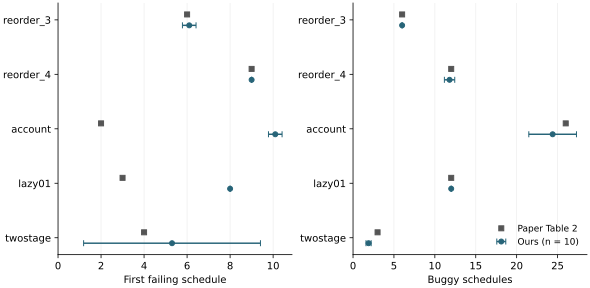
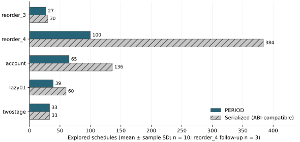
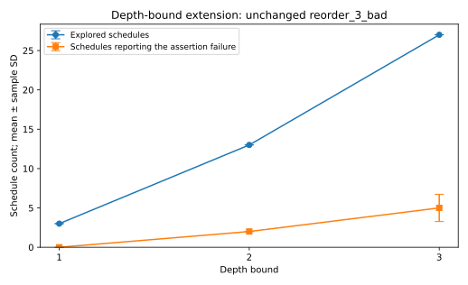
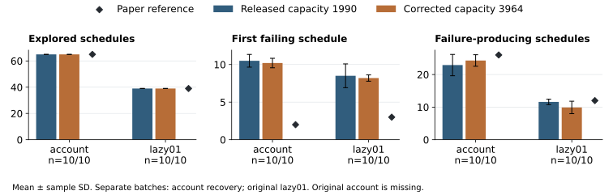

# PERIOD Replication and Controlled Diagnostics

CS340 Operating Systems · Final report revised 25 November 2026. The measurements below keep their original dates. The 14 November layout diagnostic, 15 November twostage replay and 22 November engineering acceptance are separate studies.

Group members: Sun Haoyang 孙皓扬 (1240001201), Li Yangshuo 李扬烁 (1240001156), and He Boyu 何博宇 (1240000576). Section 10 records each member's contribution and review status.

## 1. Scope, claims and principal findings

We reproduce five programs from Table 2 of Wen et al. [1] using the authors' released implementation [2]: reorder_3, reorder_4, account, lazy01 and twostage. We chose this smaller set to cover four program families and several thread counts within the available resources. The findings apply to these programs in the environments described below.

Concurrency failures depend on the order in which threads access shared state. PERIOD assigns key operations to successive execution periods: a later period waits for earlier periods to finish, while the final period can contain operations from several threads. A generator explores schedules up to a period bound. Execution feedback identifies additional dynamic key-point slices for later exploration [1, sections 2.2 and 3]. We measure both the scheduling work requested and the failures observed. These answer different questions: how much of the search space the driver explores, and how effectively that search exposes the error. Earlier failure discovery and reliable replay also need evidence of their own.

C1 asks whether we can reproduce the selected Table 2 schedule counts and failure-discovery results. C2 asks whether PERIOD requests fewer schedules than the released serialized driver on the same program while still finding its failure. Each driver uses its own bug-depth definition. The serialized driver required a small shared-memory compatibility change, so we label it author_serialized_abi16; its identity with the paper's historical Serial executable is unproven. We also vary the depth bound as a single-factor extension and test whether a replay multiplier helps explain an earlier missed assertion.

The primary expanded batch attempted 100 driver invocations: five cases, two methods and ten repetitions per method, arranged as 50 planned pairs. Ninety calls completed. All ten four-thread serialized calls reached the 120-second outer limit. A preregistered follow-up completed three same-host pairs for that case with a 240-second limit. The matched analysis therefore contains forty primary pairs and three follow-up pairs, analysed on their respective hosts. Every complete call reported the target error.

PERIOD matches all five paper reference exploration counts. Against the compatible serialized driver, it explores fewer schedules on four cases and the same number on twostage. First-failure positions and buggy-schedule counts still differ materially from the paper, giving an overall verdict of **partially reproduced**. Two later replay-diagnostic batches each reached 20/20 assertion hits under both multiplier settings, so neither explains the earlier miss.

The 14 November capacity diagnostic contributes forty readable calls from the account and lazy01 batches, analysed separately. A compiled native-layout probe confirms the corrected field offsets. Changing the capacity changes feedback hashes but leaves both requested exploration sequences unchanged. The corrected first-failure means are still 10.200 for account against the paper's 2, and 8.200 for lazy01 against 3; timing and failure yield move in different directions across the two cases. The original account evidence could not be read. Its outcomes remain unknown, and the account results reported here come from a separately registered recovery batch.

## 2. Experimental setup and registered design

We use source revision cb8deb9a176e5bb292d70d46557dd61dc0e98069 with the original benchmark source and inputs. The scripts overlay this checkout on the authors' dependency image, rebuild the static-analysis/instrumentation layer and build one target binary per case. The image is pinned to sha256:8f47d8b9148f2db579627842026e722d0f205ddeab13e70ee41a8df3dbd59fbc. Compiler and SVF dependencies come from that image, so this procedure does not rebuild every 2022 dependency from source. Each case archive includes the commands, versions, original source, license and hashes.

Appendix A lists the setup deviations; docs/DEVIATIONS.csv adds links to their archives. The source changes are the serialized IPC adapter, replay-diagnostic instrumentation and the capacity-only driver copy for the third-week study. Each is labelled separately. The benchmark and native runtime source are unchanged.

The primary batch and four-thread follow-up used Ubuntu 18.04.5 container userland, Clang 10.0.0, GCC 7.5.0, Python 3.6.9 and host kernel 7.0.0-1017-azure. The paper used Ubuntu 18.04, GCC 7.5, LLVM 10 and a Xeon Silver 4214 workstation [1, section 4.1.3]. Table 1 lists our hosted machines. Each case ran on a separate machine, with both methods sharing its host, input and built binary; the follow-up had a new host. The image fixes the userland dependencies, while processors and host kernels can differ. The earlier pilot and diagnostics are also analysed within their own batches.

**Table 1. Primary expanded-batch and follow-up hardware.** These model strings describe hosts, not shared host identities.

| Case | CPU model reported by host | Affinity |
| --- | --- | --- |
| reorder_3 | AMD EPYC 9V74 80-Core Processor | [0, 1, 2, 3] |
| reorder_4 | AMD EPYC 7763 64-Core Processor | [0, 1, 2, 3] |
| account | AMD EPYC 9V74 80-Core Processor | [0, 1, 2, 3] |
| lazy01 | AMD EPYC 9V45 96-Core Processor | [0, 1, 2, 3] |
| twostage | AMD EPYC 7763 64-Core Processor | [0, 1, 2, 3] |
| reorder_4 follow-up | AMD EPYC 7763 64-Core Processor | [0, 1, 2, 3] |

Each comparison uses depth 3 and a 10,000-schedule budget. Ten repetition pairs run sequentially, alternating method order AB/BA. The primary outer limit is 120 seconds: all ten four-thread serialized calls reached it, while the other comparisons completed. The preregistered follow-up uses three pairs and a 240-second outer limit; all six calls completed. No eligible complete call recorded an inner timeout. Runs within one container are sequential because the driver uses fixed-key shared memory. Source and binary hashes are recorded, but generated executables are excluded from the repository. An archived binary hash records the build's identity; checking it again requires the binary.

The drivers' bug-depth setting d determines the periods searched, but it is distinct from the period count p. The [parallel driver](../results/2026-11-07/comparison-42381922637/reorder_3/source/run_PDS.py) iterates over p=2 through d+1. Its [scheduler](../results/2026-11-07/comparison-42381922637/reorder_3/source/sbp_sched_mixed_end.py) puts one thread's key points in each preceding period and allows several threads in the final period. The [serialized driver](../results/2026-11-07/comparison-42381922637/reorder_3/source/run_OldPDS_abi16.py) instead iterates over p=N through d+N-1, where N is the thread count observed when enumeration begins. At d=3, the three-thread [PERIOD log](../results/2026-11-07/comparison-42381922637/reorder_3/period_r01.txt) reports periods 2, 3 and 4; the [serialized log](../results/2026-11-07/comparison-42381922637/reorder_3/author_serialized_abi16_r01.txt) reports 3, 4 and 5. For two-thread twostage, both ranges are 2 through 4.

C2 compares these released configurations with their respective depth definitions. When N exceeds 2, their absolute period ranges differ, and other driver differences remain [1, section 3.2.1; 2]. The comparison therefore measures the configurations as a whole. An explored schedule is one printed test request and its target execution attempt. Calibration and default-system runs occur before these requests are counted. A request can allow several actual interleavings.

The expanded protocol was committed at 6faea36 before measurement began. After the original driver failed, protocol 7251fb2 specified the compatibility adaptation from source and interface evidence; commit 09cfa0a then corrected runner method selection before the adapted batch was repeated. The adaptation was not tuned to the paper's counts.

The archives include all earlier attempts. Run 42380166815 failed during source loading, before benchmark execution. Run 42380929383 contains 50 complete PERIOD calls, 50 original serialized-driver crashes and 40 diagnostics. Run 42381557337 stopped after one PERIOD call per case because of a runner label error. Run 42381922637 repeats the full predefined sample, including the ten censored outcomes. Follow-up protocol 15ae481 specified run 42384122902 in advance: reorder_4 only, three AB/BA/AB pairs and a longer outer watchdog, with the source, program, internal target timeout, depth and schedule budget unchanged. Three pairs meet the course minimum and bound the extra runtime. Both methods were rerun on that host, whose observations are kept separate from the primary batch.

## 3. Paper versus measured results

Tables 2 and 3 report arithmetic mean ± sample standard deviation, using denominator n - 1. Table 2 uses ten complete PERIOD calls per case. Table 3 uses ten complete serialized calls for four cases and three follow-up calls for reorder_4. The first failing schedule is one-based. Every complete call in these tables detected an error, so the first-failure sample size equals the stated complete sample size. Buggy schedules count executions that expose a failure, rather than distinct defects. Signed delta is our mean minus the paper value; relative delta divides that difference by the paper value. The independent summary contains every trial and the corresponding descriptive gaps.

**Table 2. PERIOD versus the selected rows of paper Table 2; n=10 per case.** Reference values come from PDF page 9 [1].

| Case | Metric | Paper | Ours | Delta | Relative delta |
| --- | --- | ---: | ---: | ---: | ---: |
| reorder_3 | First failing schedule | 6 | 6.100 ± 0.316 | +0.100 | +1.67% |
| reorder_3 | Explored schedules | 27 | 27.000 ± 0.000 | +0.000 | +0.00% |
| reorder_3 | Buggy schedules | 6 | 6.000 ± 0.000 | +0.000 | +0.00% |
| reorder_4 | First failing schedule | 9 | 9.000 ± 0.000 | +0.000 | +0.00% |
| reorder_4 | Explored schedules | 100 | 100.000 ± 0.000 | +0.000 | +0.00% |
| reorder_4 | Buggy schedules | 12 | 11.800 ± 0.632 | -0.200 | -1.67% |
| account | First failing schedule | 2 | 10.100 ± 0.316 | +8.100 | +405.00% |
| account | Explored schedules | 65 | 65.000 ± 0.000 | +0.000 | +0.00% |
| account | Buggy schedules | 26 | 24.400 ± 2.914 | -1.600 | -6.15% |
| lazy01 | First failing schedule | 3 | 8.000 ± 0.000 | +5.000 | +166.67% |
| lazy01 | Explored schedules | 39 | 39.000 ± 0.000 | +0.000 | +0.00% |
| lazy01 | Buggy schedules | 12 | 12.000 ± 0.000 | +0.000 | +0.00% |
| twostage | First failing schedule | 4 | 5.300 ± 4.111 | +1.300 | +32.50% |
| twostage | Explored schedules | 33 | 33.000 ± 0.000 | +0.000 | +0.00% |
| twostage | Buggy schedules | 3 | 1.900 ± 0.316 | -1.100 | -36.67% |

**Table 3. Compatible serialized driver versus paper Serial references; n=10 except reorder_4, n=3 from follow-up 42384122902.** This is a descriptive comparison with the historical reference; the adapter and remaining implementation differences prevent a claim of exact historical executable identity.

| Case | Metric | Paper | Ours | Delta | Relative delta |
| --- | --- | ---: | ---: | ---: | ---: |
| reorder_3 | First failing schedule | 10 | 10.100 ± 0.316 | +0.100 | +1.00% |
| reorder_3 | Explored schedules | 30 | 30.000 ± 0.000 | +0.000 | +0.00% |
| reorder_3 | Buggy schedules | 10 | 9.800 ± 0.919 | -0.200 | -2.00% |
| reorder_4 | First failing schedule | 37 | 47.000 ± 0.000 | +10.000 | +27.03% |
| reorder_4 | Explored schedules | 384 | 384.000 ± 0.000 | +0.000 | +0.00% |
| reorder_4 | Buggy schedules | 90 | 86.333 ± 1.155 | -3.667 | -4.07% |
| account | First failing schedule | 4 | 7.700 ± 7.889 | +3.700 | +92.50% |
| account | Explored schedules | 136 | 136.000 ± 0.000 | +0.000 | +0.00% |
| account | Buggy schedules | 56 | 49.200 ± 8.217 | -6.800 | -12.14% |
| lazy01 | First failing schedule | 4 | 7.200 ± 7.005 | +3.200 | +80.00% |
| lazy01 | Explored schedules | 60 | 60.000 ± 0.000 | +0.000 | +0.00% |
| lazy01 | Buggy schedules | 20 | 17.700 ± 4.715 | -2.300 | -11.50% |
| twostage | First failing schedule | 4 | 4.000 ± 0.000 | +0.000 | +0.00% |
| twostage | Explored schedules | 33 | 33.000 ± 0.000 | +0.000 | +0.00% |
| twostage | Buggy schedules | 3 | 2.200 ± 0.422 | -0.800 | -26.67% |

**Figure 1.** First-failure positions and buggy-schedule counts for PERIOD. Error bars are sample SD, not confidence intervals. The five explored-schedule counts all match the paper exactly and are shown separately in Figure 2.

All ten primary PERIOD repetitions per case match the paper's exploration count. Figure 1 shows where the failure measures differ: account first fails at a mean of 10.100 against the paper's 2, a gap of +8.100 (+405.00%); lazy01 first fails at 8.000 against 3; and twostage reports 1.900 ± 0.316 buggy schedules against 3. These discrepancies drive the partial-replication verdict.

The [individual trial results](../results/2026-11-07/summaries/comparison-42381922637/all_trials.csv) help distinguish persistent gaps from occasional late failures. In the [account logs](../results/2026-11-07/comparison-42381922637/account/), PERIOD first fails at position 10 in nine runs and 11 in one; [lazy01](../results/2026-11-07/comparison-42381922637/lazy01/) first fails at 8 in all ten. Both gaps from the paper's 2 and 3 occur in every repetition. For [twostage PERIOD](../results/2026-11-07/comparison-42381922637/twostage/), nine first failures occur at 4 and one at 17, raising the mean to 5.300. Its buggy count is below the paper's 3 in every run: nine runs report 2 and one reports 1.

The serialized account driver first fails at 4 in eight runs, and at 20 and 25 in the other two. Serialized lazy01 also has eight first failures at 4, with the others at 16 and 24. Their medians equal the reference value 4, while their means reflect the late failures. These frequencies describe the observed pattern; they do not identify the actual execution order behind a delay or establish equivalence with the paper's failure distribution.

**C1 verdict: partially supported.** Across the five selected cases, we reproduce failure detection and explored-schedule counts. First-failure positions and buggy counts agree only in part. Tables 2 and 3 state the samples; section 2 describes their environments.

## 4. Matched comparison and efficiency interpretation

**Table 4. Exploration reduction relative to the compatible serialized driver.** Each count has sample SD zero; n=10 paired repetitions for four cases and n=3 for reorder_4 from follow-up 42384122902. Reductions are computed within each case as (Serial - PERIOD) / Serial.

| Case | PERIOD schedules | Serialized ABI16 schedules | Reduction |
| --- | ---: | ---: | ---: |
| reorder_3 | 27 | 30 | 10.00% |
| reorder_4 | 100 | 384 | 73.96% |
| account | 65 | 136 | 52.21% |
| lazy01 | 39 | 60 | 35.00% |
| twostage | 33 | 33 | 0.00% |

Figure 2 visualizes the matched explored-schedule counts in Table 4.

**Figure 2.** Explored schedules for both methods. Each row is a same-host, same-binary comparison; no measurements are pooled across cases. The equality on twostage is an observed result retained alongside the four reductions.

**Table 5. Whole-driver elapsed seconds.** Values and paired differences are mean ± sample SD over ten matched pairs for four cases and three for reorder_4 from the separate follow-up. Positive differences mean the serialized invocation took longer in that case.

| Case | PERIOD seconds | Serialized ABI16 seconds | Paired time difference (Serial - PERIOD) |
| --- | ---: | ---: | ---: |
| reorder_3 | 5.855 ± 0.324 | 9.553 ± 0.827 | 3.698 ± 0.925 |
| reorder_4 | 21.843 ± 0.499 | 133.962 ± 2.705 | 112.119 ± 2.913 |
| account | 23.738 ± 2.356 | 49.317 ± 7.662 | 25.579 ± 8.536 |
| lazy01 | 11.485 ± 0.434 | 16.888 ± 4.119 | 5.403 ± 3.853 |
| twostage | 2.664 ± 0.296 | 2.652 ± 0.378 | -0.011 ± 0.439 |

The times in Table 5 include calibration, target execution, detection, reporting and driver overhead. The ABI adaptation fixes the segment-size and element-width incompatibility that blocked the released serialized driver. Differences in dry-run handling, small-period scaling, default schedules and exploration logic remain, as does the location/order-array offset mismatch. Schedule counts are consequently our main structural comparison. Wall time is a secondary observation of these implementations on their recorded hosts, without extrapolation to the paper's workstation, native-program speedup or a pooled cross-host speedup.

**C2 verdict: supported within the stated comparison.** PERIOD explored fewer schedules in four of five cases and tied on twostage. Both methods detected the target error in every complete repetition. This supports search reduction against the adapted released serialized driver, using the depth-to-period mappings in section 2. The claim is limited to this comparison: other tools, arbitrary programs and the identity of the historical binary were not evaluated.

Search reduction did not consistently bring earlier failure discovery. In the primary batch, account's first-error means are 10.1 for PERIOD and 7.7 for the compatible serialized driver; lazy01 gives 8.0 and 7.2, and twostage gives 5.3 and 4.0. C2 concerns the total requested search, with failure detection retained. The first-error positions are a separate result.

## 5. Discrepancy analysis and controlled checks

### 5.1 Original serialized-driver failure and the scoped repair

All 50 original serialized calls in run 42380929383 exited with signal 11 before schedule enumeration, leaving their metrics unavailable. The old driver requests a 24,300-byte System V shared-memory segment and uses 32-bit arrays. The current C runtime uses 16-bit arrays and an x86-64 structure of 24,008 bytes; the current PERIOD driver requests 12,160 bytes. In the old driver, shmget/shmat results are copied without being checked.

The runtime had already created the smaller segment at key 1111, so the old driver's larger request could fail before the unchecked attachment was copied. An isolated IPC probe reproduced the predicted size rejection. The completed compatible jobs also queried their actual runtime key 1111: the current-size request succeeded, the original-size request returned -1 with errno 22, and an invalid attach produced the failure sentinel. These checks, the crashes before enumeration and the successful adapted runs strongly support the interface-incompatibility explanation. The isolated probe is reported separately from benchmark repetitions.

The adapter copies three IPC helper functions and changes four array element types to match the pinned current PERIOD driver. The original serialized enumeration section remains byte-identical. Each case archive contains the diff, both source versions and SHA-256 values, and the label author_serialized_abi16 identifies this adapted comparator.

A second incompatibility remained in both drivers: their arrays have 1,990 elements against the C runtime's 3,964. Their yield arrays start at the correct offset, but their location/order arrays do not. This limitation is part of the historical comparison. Section 8 tests a capacity correction in the PERIOD driver through a new, preregistered controlled study.

The original failed-driver batch also exposed a collection defect: a failed call could inherit a PERIOD witness directory from an earlier call. Those files are preserved in the archive but excluded from serialized results and bug counts. The repaired collector accepts only newly created output directories, and regression tests cover the failure path. The primary statistics are independently reconstructed from each call's own checksummed log.

### 5.2 Censoring and the predeclared completion check

All primary four-thread serialized calls reached the 120-second outer limit. Each had already reported its first error at printed schedule 47. They stopped after 272–276 printed schedules and 61–62 error events, leaving the final search total and full-driver completion time unknown. The summary records these observed prefixes separately from complete runs.

The follow-up keeps the workload and internal method settings, increases the outer window to 240 seconds, and specifies three pairs before execution. Its six completed calls supply the four-thread observations in Tables 3–5. They come from a new host and a smaller sample; the ten original censored calls remain in the archive. Changing the watchdog alone cannot explain any timing difference across those hosts.

### 5.3 Enumeration consistency and observed failure variability

Within each complete case-method condition, every repetition printed the same ordered schedule sequence. This held for nine primary conditions with ten complete repetitions each and two follow-up conditions with three each. A SHA-256 sequence audit checks that agreement; censored prefixes are assessed separately. First-error positions and buggy counts still varied, which points to differences during execution or feedback handling despite identical requests. Identifying the actual memory-operation order would require a validated execution trace. The historical location/order arrays have the offset mismatch described above.

### 5.4 Replay-multiplier sensitivity diagnostic

The original follow-up reached the expected assertion in 4/5 replays of the fixed reorder_3 witness [[0,2],[2,0],[1,0]]. The first replay missed the assertion, returned an outer driver exit code of zero and did not reach the outer timeout. That missed observation remains in the results.

Each later batch replays that fixed witness on one host and one built binary: twenty repetitions with multiplier 1.5 and twenty with 6.0, alternating AB/BA. The diagnostic driver changes the multiplier and logs the target return code and measured calibration after execution; the benchmark binary is unchanged. Every call recalibrates, as in the original driver. The piecewise runtime conversion and changing calibration mean that a fourfold multiplier need not give a fourfold kernel deadline. Table 6 reports the three replay batches separately.

**Table 6. Replay observations, kept separate by batch.**

| Batch | Multiplier 1.5 | Multiplier 6.0 | Interpretation |
| --- | --- | --- | --- |
| Original follow-up | 4/5 expected assertions | Not run | One recorded miss |
| 42380929383 | 20/20; target -6 | 20/20; target -6 | No observed setting difference |
| 42381922637 | 20/20; target -6 | 20/20; target -6 | No observed setting difference |

The diagnostic is **inconclusive for the cause of the earlier miss**. Both later batches hit the assertion on every replay under both settings, leaving no observed setting difference to explain it. The original 4/5 result and the later batches have separate denominators. These are descriptive observations because consecutive runs on one host can be dependent. A causal timing test would need a correctly decoded parent-only trace and a separately registered timing intervention.

### 5.5 Member twostage witness verification, 15 November

He Boyu's source study follows the default one-writer/one-reader twostage program to the assertion at line 48. The writer publishes two related values under separate mutexes. The reader can then store local t1 = 1 and t2 = 0, violating t2 = t1 + 1. The pinned source and matching assertion imply those values and their necessary partial order. The archive contains no timed instruction trace from which to recover a unique lock order [9].

The selected witness comes from PERIOD repetition 1, test 4 in archive 42381922637. On 15 November, run 43681034375 rebuilt the pinned source in the recorded image and replayed that witness five times with the stock driver. All five outputs contain the line-48 funcB assertion after the reproduction marker. The 12 host/build/replay files are checksummed, and the rebuilt target hash matches the original archive's target hash. The assertion is the success criterion; the wrapper's zero exit code alone would be insufficient. These five replays show repeatability for this input, build and host [9]. They are not an estimate of unconditional replay reliability or extra samples for the earlier exploration tables.

## 6. Single-factor depth-bound extension

The original follow-up also varied depth on one reorder_3 binary and host. Depth was the only changed factor: 1, 2 and 3, in balanced repetition orders (1,2,3), (3,1,2), (2,3,1), with the same input and budget and three repetitions per condition. Bounds 1 and 2 extend the paper's depth-3 setting. Table 7 reports this study, whose timings are kept separate from the expanded comparison.

**Table 7. Depth-bound extension, mean ± sample SD, n=3.**

| Bound | Explored schedules | Buggy schedules | Runs detecting failure | First failing schedule | Whole-driver seconds |
| ---: | ---: | ---: | ---: | ---: | ---: |
| 1 | 3.000 ± 0.000 | 0.000 ± 0.000 | 0/3 | Not observed | 0.371 ± 0.092 |
| 2 | 13.000 ± 0.000 | 2.000 ± 0.000 | 3/3 | 6.000 ± 0.000 | 2.877 ± 0.198 |
| 3 | 27.000 ± 0.000 | 5.000 ± 1.732 | 3/3 | 6.000 ± 0.000 | 6.459 ± 1.975 |

Figure 3 visualizes the depth-bound results.

**Figure 3.** Earlier single-factor depth study with sample SD. Connected discrete bounds do not imply measurements at intermediate settings.

The [nine extension logs](../results/2026-11-07/followup/) contain a nested request sequence in every repetition. The three depth-1 requests and thirteen depth-2 requests are prefixes of the twenty-seven depth-3 requests. The [depth-3 sequence](../results/2026-11-07/followup/extension_d3_r1.txt) has three requests with two periods, ten with three periods and fourteen with four periods. All six depth-2 and depth-3 runs first fail at request 6, [[0],[2],[0,1,1]], in the newly added three-period layer.

The [benchmark source](../results/2026-11-07/comparison-42381922637/reorder_3/source/reorder_3_bad.c) explains why this layer can expose the error. It creates two setters and then a checker. Each setter writes a=1 followed by b=-1; the checker accepts only (0,0) or (1,-1). Request 6 separates one setter's first key point from its remaining work and places the checker between them, allowing it to observe the inconsistent state (1,0). This explanation follows from the requested order and source. The actual memory-operation traces were not recorded.

Depth 2 found the known failure in all three repetitions while exploring 51.85% fewer schedules than depth 3 and taking less whole-driver time. Depth 3 found additional failing schedules. For this defect, depth 2 finds fewer failure-producing schedules while reducing search work. Time to the first failure was not measured separately. Depth 1 produced no observed failure within its bound, which leaves program correctness undecided.

## 7. Independent host corroboration

Li Yangshuo's 8 November batch reruns account on an Intel Core i5-14490F host with 16 permitted CPUs and WSL2 kernel 6.18.33.2-microsoft-standard-WSL2. It uses the original compatible comparison's source pin, image, depth, budget and driver versions. All twenty calls completed without recorded inner or outer timeouts, giving ten pairs on this additional host. The `make audit-member` command independently checks the 880 manifest entries, raw logs and published statistics; it also runs within `make audit` and continuous checks.

Table 8 reports the independent-host results.

**Table 8. Independent account rerun, mean ± sample SD, n=10 per method.** The reported whole-driver times belong only to the WSL2 batch.

| Method | First failing schedule | Explored schedules | Buggy schedules | Whole-driver seconds |
| --- | ---: | ---: | ---: | ---: |
| PERIOD | 8.800 ± 2.044 | 65.000 ± 0.000 | 26.400 ± 0.843 | 6.855 ± 0.155 |
| author_serialized_abi16 | 4.000 ± 0.000 | 136.000 ± 0.000 | 55.900 ± 0.316 | 12.167 ± 0.396 |

The additional host again gives a 52.21% schedule reduction and a paired whole-driver time difference of 5.312 ± 0.377 seconds, serialized minus PERIOD. The first-failure discrepancy persists: PERIOD's mean is 6.800 positions above the paper's reference of 2 (+340.00%). Its buggy-count difference from the paper's 26 is +0.400 (+1.54%), while the serialized result differs from 56 by -0.100 (-0.18%). The remaining displayed count differences from their paper references are zero.

These results corroborate the account search-count comparison on another host. Hardware, kernel and calibration all changed between batches, so they cannot individually explain the shorter elapsed times or different failure counts. Each batch keeps its own sample size and host record [5].

Li Yangshuo's supplementary review [10] compares his 8 November run with the group's 7 and 14 November evidence. Normalized full test lines give one request-sequence hash per driver across the original and member batches, despite varying failure observations. This is secondary analysis: PR #3 adds no calls and does not claim the group's capacity repair or first discovery as the submitter's own work. The maintainer's `make audit-member-reviews` reproduces the 40 sequence checks from checksummed logs.

## 8. Controlled shared-memory capacity diagnostic

### 8.1 Question, intervention and native field validation

The earlier comparison exposed a possible source of distorted feedback. Each key-point array in the Python driver has 1,990 elements, while the pinned C runtime declares 3,964. As a result, the later arrays begin at different byte offsets. We selected account and lazy01 before measurement because both had large first-failure gaps in the primary batch. This targeted diagnostic tests those two cases; it does not sample the full suite at random.

Protocol bddb831 preceded workflow 43570556202 [6]. Condition A uses the released capacity1990 driver. Condition B changes one declaration to capacity3964. Within each case, the native runtime, benchmark, compiled binary, input, scheduler logic, depth 3, budget 10,000 and 120-second outer limit stay fixed. The ten planned pairs alternate AB/BA. Before every call in both arms, key 1111 is absent in private IPC/PID namespaces; any residual processes for the exact target are removed and recorded. This reset procedure differs from the historical runs. The capacity effect is therefore assessed between the paired arms of each new batch, not by comparing a new arm with an older batch.

A compiled declaration-only probe checks the pinned runtime structure. Table 9 gives its field offsets; the native structure occupies 24,008 bytes. The corrected Python mapping spans 24,004 bytes through the last used field, with four bytes of native tail padding. The used field offsets agree. A separate synthetic sentinel checks decoder behavior and contributes no workload result.

**Table 9. Byte offsets validated against the native declaration.** The driver labels identify array capacities, not counts of measured execution events.

| Field | Native runtime | Released capacity1990 | Corrected capacity3964 |
| --- | ---: | ---: | ---: |
| kp, scheduling/yield array | 220 | 220 | 220 |
| kpLoc, key-point location array | 8,148 | 4,200 | 8,148 |
| kpOrder, key-point order array | 16,076 | 8,180 | 16,076 |

### 8.2 Actual outcomes and controlled interpretation

The original lazy01 job produced a readable archive of twenty calls. The account measurement step failed at 07:30:52 UTC, and its job ended in failure at 08:16:50 UTC. Two later artifact checks found no account results; fetching the job log returned 404 BlobNotFound. We could not determine the failure cause or actual call count. Twenty account calls were planned, but their outcomes remain unknown rather than zero.

Recovery registration ea273fe4 preceded workflow 43575584325. It specified a new twenty-call account batch on a new host, using the four original measurement wrapper/helper files from bddb831 without changes. The preservation procedure now commits raw evidence to Git before uploading a backup ZIP. The recovery was needed because the original evidence was unavailable; there were no readable account results to select for a favorable outcome. The successful original lazy01 batch was kept without rerunning it [6].

Table 10 separates the planned, readable and complete workload denominators.

**Table 10. Planned and observable workload denominators.** Each original case planned ten pairs. Recovery is a distinct fixed sample on a new host. Eligible calls require complete enumeration and no inner timeout, outer timeout or budget censoring; probes and builds are excluded.

| Scope | Planned | Recorded | Complete | Eligible | Complete pairs |
| --- | ---: | ---: | ---: | ---: | ---: |
| Original account, run 43570556202 | 20 | Unknown | Unknown | Unknown | Unknown |
| Original lazy01, run 43570556202 | 20 | 20 | 20 | 20 | 10 |
| Recovery account, run 43575584325 | 20 | 20 | 20 | 20 | 10 |

All forty readable calls completed and exposed the target assertion, with no recorded inner or outer timeout, budget stop or other error type. Each case supplies ten eligible pairs on its own host. The original account call count is unknown, so these forty observations cannot be attributed to the original protocol alone. The original lazy01 host was AMD EPYC 9V74; the recovery account host was AMD EPYC 9V45. Both allowed CPUs [0, 1, 2, 3] and recorded kernel 7.0.0-1017-azure, Ubuntu 18.04.5 userland and Python 3.6.9.

Table 11 reports the controlled capacity outcomes.

**Table 11. Controlled capacity results, mean ± sample SD.** A denotes released capacity1990; B denotes corrected capacity3964. First-failure means use complete eligible calls with a detected error; here every eligible call detected the assertion. Account and lazy01 retain their separate batches from Table 10.

| Case / condition | n | First failing schedule | Explored schedules | Buggy schedules | Whole-driver seconds |
| --- | ---: | ---: | ---: | ---: | ---: |
| account / A | 10 | 10.500 ± 0.850 | 65.000 ± 0.000 | 22.900 ± 3.281 | 23.569 ± 3.547 |
| account / B | 10 | 10.200 ± 0.632 | 65.000 ± 0.000 | 24.300 ± 1.767 | 24.639 ± 2.040 |
| lazy01 / A | 10 | 8.500 ± 1.581 | 39.000 ± 0.000 | 11.600 ± 0.843 | 10.994 ± 0.722 |
| lazy01 / B | 10 | 8.200 ± 0.422 | 39.000 ± 0.000 | 9.900 ± 1.912 | 9.605 ± 1.608 |

Both capacities reproduce the paper's exploration totals of 65 for account and 39 for lazy01, with zero absolute and relative gaps. For account, A/B first-failure gaps from the reference 2 are +8.500 (+425.00%) and +8.200 (+410.00%); buggy-count gaps from 26 are -3.100 (-11.92%) and -1.700 (-6.54%). For lazy01, A/B first-failure gaps from 3 are +5.500 (+183.33%) and +5.200 (+173.33%); buggy-count gaps from 12 are -0.400 (-3.33%) and -2.100 (-17.50%). The correction leaves substantial first-failure discrepancies in both cases.

Table 12 reports the within-pair changes.

**Table 12. Within-pair change, B minus A, mean ± sample SD.** Each row contains ten complete pairs on its own case host. A negative time difference means a shorter corrected-driver invocation; these observations do not estimate paper-workstation speedups.

| Case / pairs | First-failure delta | Schedule-count delta | Buggy-count delta | Elapsed-second delta |
| --- | ---: | ---: | ---: | ---: |
| account / 10 | -0.300 ± 1.160 | +0.000 ± 0.000 | +1.400 ± 4.402 | +1.070 ± 4.323 |
| lazy01 / 10 | -0.300 ± 1.337 | +0.000 ± 0.000 | -1.700 ± 2.003 | -1.390 ± 1.525 |

Figure 4 visualizes the controlled capacity outcomes.

**Figure 4.** Means and sample SD from the forty readable calls, with paper values as descriptive references. The account bars use recovery run 43575584325; lazy01 uses original run 43570556202. Missing original account outcomes are excluded and remain unknown. Each plotted metric has n=10 per condition.

The requested schedule sequences agree within and across capacities: all ten pairs match for both account and lazy01. After the correction, account has slightly more failure-producing schedules and a longer mean elapsed time, while lazy01 has fewer failure-producing schedules and a shorter time. This mixed result gives no general speed or failure-yield advantage. The field-offset repair preserves the requests in these two cases, yet the first-failure gaps remain. The estimates are descriptive because repeated calls on one host may be dependent; no independence-based significance test is applied. The audit checks every raw file and the original runner-source bytes before calculating these results [6, 8].

### 8.3 Feedback changes and a source-backed execution mechanism

The feedback hashes change consistently with the repair. Across the ten calls in each lazy01 condition, the default coverage hash changes from 8 to 185,480. In all ten calls per account condition, it changes from 18 to 196,202. The location array feeds calculate_coverage_hashID, which helps select additional dynamic key-point slices [2]. The changed hashes show that the corrected decoder affects actual execution feedback. Even so, both arms request the same 39 lazy01 and 65 account schedules, with no additional dynamic slice in these enumerations. The hashes are auxiliary observations from existing stdout; the preregistered outcomes remain schedule and failure metrics.

The account source shows how an unchanged request can produce different outcomes. It creates checker thread 0, deposit thread 1 and withdrawal thread 2. With x=1, y=2 and z=4, the completed balance is -1; the deliberately faulty assertion expects -5. Request 2, [[1,1,1],[0,0,2,2,2]], puts the checker and withdrawal in the same final period after the deposit. If withdrawal acquires the mutex first, both completion flags are true when the checker evaluates the assertion. If the checker gets it first, withdraw_done is false and the assertion is skipped. These are two orders allowed by the source and request. A validated memory-operation trace would be needed to identify which order occurred in a particular recorded call.

The diagnostic confirms the decoder mismatch and tests a controlled repair. Correct field offsets, changed feedback hashes and observed failure counts answer different parts of that question. The independent review documents the source paths, offset checks, witnesses and interpretation limits [8].

## 9. Evidence, verification and dated progress

The primary archive is results/2026-11-07/comparison-42381922637, and the four-thread follow-up is comparison-42384122902. Each case contains records.json, command logs, source, environment and image/compiler metadata, the compatibility diff, an IPC probe and a manifest. The outer archive_manifest.json records the retained files' hashes. An independent summarizer verifies these and the driver-source hashes, reads the recorded commands and runner footers, and recounts test, error and timeout events. It also checks the planned AB/BA order and actual sample sizes, keeping incomplete calls separate. JSON and CSV summaries are under summaries/comparison-42381922637; the failed original comparison has its own summary. Host records and denominators stay with their respective batches.

The capacity diagnostic has one checked summary for original lazy01 and another for recovery account. Their outer manifests cover 304 and 571 files; the case manifests cover 300 and 557, respectively. The recovery archive includes its activation record and four original runner sources that match bddb831 byte for byte. All 215 lazy01 and 472 account witness files contain the expected assertion failure. The missing original account results cannot be reconstructed from its job metadata or failed log-retrieval responses, which are kept outside the measured summaries.

The audit uses its own parser, separate from the measurement runner. Test fixtures are labelled synthetic and excluded from measured summaries; a call with no observed target error has no first-failure value. Both source/measurement streams and their bounded failure witnesses are retained with the upstream license. Instructor material and compiled outputs are excluded. README.md gives reproduction commands, expected output and runtime limits. `make audit` reruns the checks, and `make summarize` regenerates descriptive summaries; the report and figures can also be rebuilt from their sources and audited data.

On 16 November, an offline member-review check was added to the default audit and continuous checks. It verifies the 12 replay-file digests and requires the matching assertion after the reproduction marker in all five completed calls. Missing evidence, a timeout or an absent assertion fails the check, and synthetic negative tests exercise those paths. It verifies existing replays; it records neither new runs nor a student's oral understanding.

The 22 November review [11] led to a traceability check for Tables 2–12. It compares them with audited summaries, historical log recounts and native-layout records, checking rounded statistics, sample sizes, paper gaps, paired-difference signs, unknown results and batch labels. The 18 table/figure captions must be uniquely numbered and cited in the text, and all four figure files must exist. Mutation tests check that incorrect values, missing references and changed batch scopes are rejected. These bindings support the numerical review; prose and rendered pages still need separate inspection. One revision-date file controls the report and checklist exports.

The 22 November engineering acceptance tested the repaired build/run commands on five fresh case hosts [12]. Protocol 2de3787 was committed before run 45015126850, attempt 1. It specified three calls per method per case, depth 3, a 10,000-schedule budget and a 240-second outer limit. All 30 comparison calls completed and were eligible, giving 15 within-case pairs. Forty additional reorder_3 witness diagnostics, twenty per multiplier, also completed and reached the matching assertion. All five benchmark builds succeeded. The outer manifest covers 948 raw files, and no comparison recorded an inner timeout, outer timeout or budget stop.

The PERIOD/serialized request totals were 27/30, 100/384, 65/136, 39/60 and 33/33 for reorder_3, reorder_4, account, lazy01 and twostage, respectively. This confirms that the registered procedure ran successfully on those hosts. The n=3 acceptance summaries are separate from Tables 2–12 and the earlier 106 attempts, 96 complete calls and 43 complete pairs. Results on another machine may differ, particularly in failure observations.

He Boyu's PR #6 independently recounts the acceptance batch's six twostage logs and clarifies the presentation's source explanation [13]. PERIOD first fails at requests 4, 4 and 4; the serialized calls first fail at 4, 29 and 4. Each explores 33 requests. For the serialized driver, the first-failure mean is 37/3 = 12.3333 and the sample SD is 25/sqrt(3) = 14.4338. These are three complete searches per method on the acceptance host. They are separate from both the 15 November five-call fixed-witness replay and the historical comparison. The recount offers a short offline demonstration: follow an assertion in a raw log through to its reported statistic.

Two submissions on 24 November extend the validation work. He Boyu added three synthetic regressions for the twostage recount: first-error indexing, duplicate errors within one schedule and rejection of a missing end marker [14]. Li Yangshuo audited the v1.0.1 assets and Windows analysis path, independently reconstructed the acceptance metrics, and added parser and evidence-manifest checks [15]. Integration review subsequently tightened footer whitespace/order handling, rejected events outside the acceptance test body and confined validation paths to the repository. These checks reuse existing logs and add no experimental samples.

The original pilot/follow-up contains 33 test/replay calls, six builds and one capability probe. The probe successfully requested SCHED_DEADLINE in that environment; it does not trace every instruction in later runs. The expanded comparisons, diagnostics, setup failures and partial attempts have their own records, with dates preserved in the logs and commits.

The progress record starts with repository preparation on 24 October and substantive safeguard/test work on 30 October. Measurements followed on 7, 8, 14, 15 and 22 November, with final integration on 24–25 November. Original authors and dates remain in Git history. The course document specifies Sunday 23:59 checks but gives no explicit timezone or first calendar check. The group uses Macau/Beijing time for planning and records that assumption [3].

## 10. Conclusion, limitations and contributions

**Overall verdict:** PERIOD is partially reproduced in this five-case, bounded comparison.

The clearest result is agreement on exploration counts: PERIOD reduces requested search against the adapted released baseline in four cases and ties in one. Failure-discovery measures agree less closely with the paper. The capacity study confirms a shared-memory interface defect and its effect on feedback, yet correcting it leaves the requested sequences unchanged and substantial first-failure gaps unresolved.

Several limits matter when interpreting this result. The five programs were chosen purposefully, runs used different hosted hardware, and the released drivers retain implementation differences. Historical comparisons also include the layout mismatch. The capacity study lost the original account evidence, repeated calls share one host per case, and the most expensive comparison has only a three-pair completed follow-up. Some failure variability remains unexplained. These results support the stated local comparison, without establishing the full paper's broader effectiveness or runtime claims. Original crashes, censored calls and replay misses remain part of the evidence; the controlled diagnostic adds an explanation for the interface behavior without replacing those observations.

Table 13 records the member contributions and their source submissions.

**Table 13. Recorded member contributions.** Original commits and authors remain in the repository. The dated record identifies assistance and actual review status [7].

| Member | Recorded contribution | Submission evidence |
| --- | --- | --- |
| Sun Haoyang, 孙皓扬, 1240001201, Sasuke-666 | Confirmed identities and authorized studies and integration; coordinated the registered fresh-host acceptance, evidence checks, member integrations and final report/presentation handoff; authorized the final parser fixes and release reconciliation | Protocols bddb831, ea273fe4 and 2de3787; acceptance archive 7284180; member PR integrations and dated contribution record [7, 12] |
| Li Yangshuo, 李扬烁, 1240001156, barkhorn996 | Submitted the independent 20-call account rerun and retained setup failure; later added cross-batch and report traceability reviews, release/Windows verification, independent acceptance metrics and parser checks | PR #2: 8ce522d and 9f30843 [5]; PR #3: 94a35c3 and d907517 [10]; PR #5: 7ac3a655 [11]; PR #8: 69484e3 [15] |
| He Boyu, 何博宇, 1240000576, heboyu0714 | Submitted the 26-log four-thread audit, twostage source-derived partial order and five witness replays; independently recounted six later acceptance logs, revised the presentation and added three synthetic recount regressions | PR #1: b02adef5 [7]; PR #4 and run 43681034375 [9]; PR #6: 9b0f265 and 2aea86e [13]; PR #7: 95731d9 and e4db8da [14] |

The report and evidence are archived in release v1.0.3. Table 13 and the dated
contribution record [7] identify who submitted each measurement, analysis and
test. The AI usage statement describes assistance with implementation, execution
and writing.

## Appendix A Complete setup deviations

Table A1 consolidates the consequential deviations from the paper setup.

**Table A1. Consequential differences and controlled extensions.** Paper settings are taken from [1, section 4.1.3 and Table 2]. Where the paper does not supply a value or exact implementation identity, that uncertainty is stated. The full machine-readable record is docs/DEVIATIONS.csv. Host-level differences are recorded even when a container dependency is pinned.

| Item | Paper or original reference | Setting used in this study | Reason and interpretation |
| --- | --- | --- | --- |
| Workload coverage | 36 SCTBench programs and a separate real-world evaluation | Five selected SCTBench programs; four families and 2–4 threads | Feasible purposeful scope; no complete-suite or real-world effectiveness claim |
| Source identity | Authors' evaluated implementation; precise experimental checkout unspecified | Released source cb8deb9a176e5bb292d70d46557dd61dc0e98069 | Rebuildable source pin; historical executable identity remains unproven |
| Competitors | Serial and several other testing tools | PERIOD versus released author_serialized_abi16 | One explicit adapted baseline; other tools remain outside scope |
| Serialized interface | Older released run_OldPDS.py uses incompatible element widths and memory request | Three IPC helpers and four array types copied from current PERIOD driver | Enables execution; serialized scheduling section is byte-identical; other driver differences remain |
| CPU and affinity | Xeon Silver 4214 workstation | Per-case hosted AMD CPUs, usually four permitted CPUs; WSL2 account host uses i5-14490F and 16 CPUs | Compare methods within one host; do not infer a paper-workstation speedup |
| Kernel and host | Exact kernel release unspecified in the cited paper setup | Original hosted studies: 7.0.0-1017-azure; member rerun: WSL2 6.18.33.2; layout lazy01: EPYC 9V74; recovery account: EPYC 9V45; both kernel 7.0.0-1017-azure | Image pins userland, not kernel; keep host scopes separate |
| OS userland | Ubuntu 18.04 | Authors' Ubuntu 18.04.5 image at the recorded digest | Closely specified released environment; no claim of byte-identical 2022 machine |
| Compiler and dependencies | LLVM 10 and GCC 7.5 | Clang 10.0.0 and GCC 7.5 where recorded; installed SVF/compiler from pinned image, instrumentation rebuilt | Original dependency source bootstrap is outside scope; use each batch's actual version record |
| Repetition count | Ten repetitions per program | Main comparison: ten per method; four-thread completion: three; depth levels: three; member host: ten; layout conditions: ten complete per condition in each readable batch; original account actual counts unknown | Separate sample sizes and all actual missing/censored observations remain explicit |
| Depth and budget | SCTBench depth 3; schedule budget 10,000 | Main and layout comparisons keep depth 3 and budget 10,000; depth extension varies 1/2/3 only | Extension tests lower bounds; bounded observations cannot establish correctness |
| Outer time limits | No matching external watchdog specified in the cited setup | Historical exploration/replay/build: 90/20/180 seconds; main comparison: 120; four-thread completion: 240; layout: 120 | Finite resource bounds; preserve censored prefixes and missing final totals |
| Memory layout | Released Python capacity 1,990; native runtime capacity 3,964 | Historical comparisons retain this mismatch; separate diagnostic changes only Python capacity | Tests a disclosed implementation threat; new observations do not replace historical ones |
| Invocation state | Earlier batches retain the released fixed-key IPC behavior | Layout diagnostic verifies fresh key 1111 for both arms and cleans exact-target residual processes in private namespaces | Same procedure within the new comparison; historical-to-new changes have multiple factors |
| Replay diagnostic | Released replay multiplier 1.5 | Twenty repeated replays per setting at 1.5 and 6.0 within each separate diagnostic host | Diagnostic copy logs return code and calibration; all-hit results do not explain the earlier miss |
| Timing metric | Published experimental environment and metrics | Whole Python-driver wall time, including calibration and reporting | Secondary implementation observation; neither native execution time nor separately measured time-to-first-failure |
| Layout evidence recovery | Original two-case protocol, ten pairs each | Original lazy01 archive retained; original account failed without readable logs or results; new account batch separately registered with original runner bytes | Original account actual counts remain unknown; recovery host and all outcomes remain separate |
| Twostage witness follow-up | Archived two-worker input from PERIOD test 4 | Five stock-driver replays on 15 November; Intel Xeon Platinum 8573C, four permitted CPUs, kernel 7.0.0-1017-azure, pinned container; 30-second wrapper limit | Separate input/host scope, no capacity modification; five observed assertions do not establish universal replay reliability [9] |
| Fresh-host engineering acceptance | Existing registered build/run path and published comparison settings | 22 November: five case hosts, three calls per method per case, 240-second outer limit; 30 complete comparisons and 40 separate diagnostics | Independent acceptance scope; earlier estimates and their missing/censored observations remain unchanged [12] |
| Evidence and dependency limits | Paper's original testbed | Source, commands, logs, manifests and binary hashes retained; generated binaries excluded | Binary hashes record provenance; rebuilds can differ; no unsupported byte-for-byte binary replication claim |

## References

[1] Wen, C., He, M., Wu, B., Xu, Z. and Qin, S. Controlled Concurrency Testing via Periodical Scheduling. ICSE 2022. DOI: 10.1145/3510003.3510178. Table 2, PDF p. 9; experiment settings, section 4.1.3.
https://wcventure.github.io/pdf/ICSE2022_PERIOD.pdf

[2] Authors' implementation, source revision cb8deb9a176e5bb292d70d46557dd61dc0e98069.
https://github.com/wcventure/PERIOD

[3] Instructor-provided CS340 Research Paper Replication, Academic Year 2026–2027, 5 pages. Report requirements: pp. 2–3; Git-history requirements: pp. 3–4. Course source retained by the students; not redistributed in this repository.

[4] Registered protocols and exact study archives in the project repository. Main comparison workflow: https://github.com/Sasuke-666/CS340-Research-Paper-Replication/actions/runs/42381922637

[5] Li Yangshuo's independent account rerun and separately audited summary, 8 November 2026.
https://github.com/Sasuke-666/CS340-Research-Paper-Replication/tree/v1.0.2/results/member-reruns/1240001156-account-20261108T122201Z-summary

[6] Capacity-layout protocol, registration bddb831, and original study workflow, 14 November 2026.
https://github.com/Sasuke-666/CS340-Research-Paper-Replication/blob/bddb831319679c30586d9bbe689fb11b897f1a14/experiments/2026-11-14/LAYOUT_PROTOCOL.md
https://github.com/Sasuke-666/CS340-Research-Paper-Replication/actions/runs/43570556202
Recovery registration ea273fe4 and separate account evidence:
https://github.com/Sasuke-666/CS340-Research-Paper-Replication/blob/ea273fe4b6e49bd1f8f5c5b7c964c02aaf22d144/experiments/2026-11-14/ACCOUNT_RECOVERY_PROTOCOL.md
https://github.com/Sasuke-666/CS340-Research-Paper-Replication/actions/runs/43575584325

[7] Dated contributions and member evidence reviews, final integration 25 November 2026.
https://github.com/Sasuke-666/CS340-Research-Paper-Replication/blob/v1.0.3/docs/CONTRIBUTIONS.csv
https://github.com/Sasuke-666/CS340-Research-Paper-Replication/tree/v1.0.2/docs/reviews

[8] Independent scientific review of the controlled layout diagnostic, 14 November 2026.
https://github.com/Sasuke-666/CS340-Research-Paper-Replication/blob/v1.0.2/docs/LAYOUT_DIAGNOSTIC_REVIEW_20261114.md

[9] He Boyu, twostage source and witness study, PR #4, submitted 15 November 2026; integrated 16 November.
https://github.com/Sasuke-666/CS340-Research-Paper-Replication/blob/v1.0.2/docs/reviews/1240000576-twostage-witness-review.md
https://github.com/Sasuke-666/CS340-Research-Paper-Replication/actions/runs/43681034375

[10] Li Yangshuo, supplementary account evidence review, PR #3, 14 November 2026; provenance clarification 15 November; integrated 16 November.
[Account supplementary analysis and source comparison](../docs/reviews/1240001156-account-supplement.md)

[11] Li Yangshuo, report traceability audit and figure/table reference corrections, PR #5, 22 November 2026.
https://github.com/Sasuke-666/CS340-Research-Paper-Replication/blob/v1.0.2/docs/reviews/1240001156-report-traceability-audit.md

[12] Registered fresh-host engineering acceptance, 22 November 2026. Protocol 2de3787; run 45015126850, attempt 1; independent receipt and separately scoped summaries.
https://github.com/Sasuke-666/CS340-Research-Paper-Replication/blob/2de378771adbeeced2709f9bc4ca436799848197/experiments/2026-11-22/ACCEPTANCE_PROTOCOL.md
https://github.com/Sasuke-666/CS340-Research-Paper-Replication/tree/8b3102c64214e53782ca0496b61c81f50fb17ff1/results/2026-11-22/summaries/acceptance-45015126850-attempt1

[13] He Boyu, independent recount of six archived twostage acceptance calls and presentation review, PR #6, submitted 22 November and integrated 24 November 2026. Secondary review; original measurements belong to the registered group acceptance batch.
https://github.com/Sasuke-666/CS340-Research-Paper-Replication/blob/2aea86e1f35fdd8f2b482aec5f4b65b0568f0c9a/docs/reviews/1240000576-presentation-check-20261122.md
https://github.com/Sasuke-666/CS340-Research-Paper-Replication/pull/6

[14] He Boyu, three synthetic regression tests for the twostage acceptance recount, PR #7, submitted 24 November 2026.
https://github.com/Sasuke-666/CS340-Research-Paper-Replication/pull/7

[15] Li Yangshuo, release and Windows audit, independent acceptance metrics and evidence-parser checks, PR #8, submitted 24 November 2026; maintainer corrections and integration on 25 November.
https://github.com/Sasuke-666/CS340-Research-Paper-Replication/pull/8
https://github.com/Sasuke-666/CS340-Research-Paper-Replication/blob/v1.0.2/docs/FINAL_VALIDATION_20261125.md
