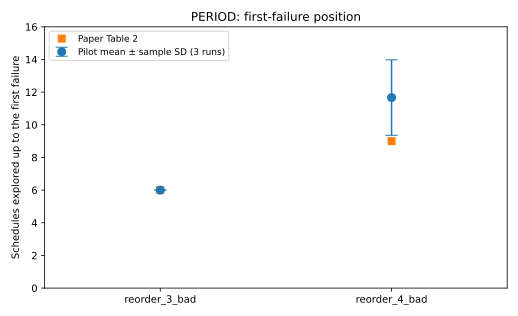
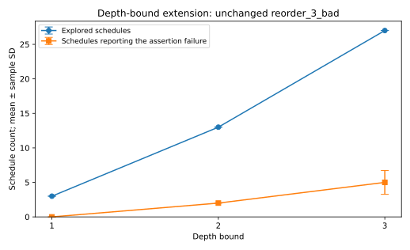

# PERIOD: scoped replication and depth-bound study

CS340 Operating Systems · Stage report · 7 November 2026

## 1. Introduction and claims

This study examines two original programs from Table 2 of Wen et al. [1],
`CS.reorder_3_bad` and `CS.reorder_4_bad`, using the authors' implementation [2].
C1 concerns their assertion-failure discovery and schedule counts. A supplementary
robustness diagnostic, D1, examines
whether selected recorded failure patterns reproduce the expected failure.
The authors' double-free example is a separate installation check. No SERIAL or
other competitor was run, so comparative superiority is outside the tested scope.

The first protocol was committed before execution (`bf5e6de`). The follow-up
protocol (`5970167`) was fixed after inspecting the pilot and before collecting
its own measurements. All attempts are retained. There are 9 pilot invocations,
9 extension invocations and 15 targeted replays, plus 6 builds and one capability
probe. These categories are not pooled into an artificial sample size.

## 2. Reproduction setup

The source commit is `cb8deb9a176e5bb292d70d46557dd61dc0e98069`. The original
benchmark programs were not edited. The wrapper overlays the pinned checkout
onto the authors' dependency image and rebuilds the static-analysis/instrumentation
layer and each target. The image is pinned to digest
`sha256:8f47d8b9148f2db579627842026e722d0f205ddeab13e70ee41a8df3dbd59fbc`.
The retained license is in `pilot/upstream_LICENSE.txt` under the evidence root.

Both measured batches used Ubuntu 18.04.5 inside the container, Clang 10.0.0,
Python 3.6.9, kernel 7.0.0-1017-azure, and CPU affinity [0,1]. The follow-up CPU
was reported as AMD EPYC 7763; the pilot CPU model was not captured and is not
assumed identical. The hosts were separate disposable hosted machines. Docker
pins the container contents but does not pin a host kernel or processor.
The container contains installed compiler/SVF dependencies; this is not a fresh
source build of every component of the authors' 2022 environment.

The paper's section 4.1.3 specifies a Xeon Silver 4214 workstation, Ubuntu 18.04,
GCC 7.5, LLVM 10.0, ten repetitions, and a depth-3 / 10,000-schedule configuration
for SCTBench. Here, three repetitions per exploration condition satisfy the course
minimum, with a reduced set of two original cases. GCC's actual version was not
separately captured. See [DEVIATIONS.csv](../docs/DEVIATIONS.csv) for all recorded
scope, hardware, configuration and measurement differences.

The main invocation is `python3 tool/DBDS/run_PDS.py -y -d 3 -f 10000 ./TARGET`.
Runs are sequential because the upstream implementation uses a fixed shared-memory
key. Outer limits were 90 seconds for exploration and 20 seconds for replay;
none of these recorded invocations reached the outer limit. Whole-driver time
includes dry-run calibration, detection, reporting and driver overhead.
It is not a measurement of a target's native runtime.

A separate child-process probe in the follow-up successfully requested
SCHED_DEADLINE: return 0, errno 0, observed policy 6. This rules out complete lack
of that permission in the follow-up environment. It does not establish that every
instruction in every experiment followed an ideal timing model.

## 3. Results and Paper vs. Ours

**Table 1. Primary pilot results.** Each local value is mean ± sample standard
deviation across three invocations. Paper reference numbers are transcribed
from Table 2, PDF p. 9. Delta is local mean minus the paper value; percentage is
that delta divided by the paper value. Counts describe schedules, not distinct
bugs. The first-failure position is one-based.

| Case | Metric | Paper | Ours, n=3 | Delta | Relative delta |
| --- | --- | ---: | ---: | ---: | ---: |
| reorder_3_bad | First failing schedule | 6 | 6.000 ± 0.000 | 0.000 | 0.00% |
| reorder_3_bad | Explored schedules | 27 | 27.000 ± 0.000 | 0.000 | 0.00% |
| reorder_3_bad | Buggy schedules | 6 | 6.000 ± 0.000 | 0.000 | 0.00% |
| reorder_4_bad | First failing schedule | 9 | 11.667 ± 2.309 | +2.667 | +29.63% |
| reorder_4_bad | Explored schedules | 100 | 100.000 ± 0.000 | 0.000 | 0.00% |
| reorder_4_bad | Buggy schedules | 12 | 10.667 ± 2.309 | -1.333 | -11.11% |

For the four-thread case the actual first-failure sequence was 13, 9, 13, and
the buggy-schedule sequence was 12, 12, 8. All three invocations detected the
assertion failure. The three-thread primary pilot exactly matched the selected
row, but later observations below show that this does not establish invariant
counts across other executions.

**Figure 1.** First failing schedule, with sample SD rather than a confidence
interval. The three-thread paper and pilot markers coincide at 6.

The separate smoke example explored 6 schedules and first failed at schedule 3
in every run. Its buggy-schedule counts were 4, 3, 4: 3.667 ± 0.577, compared with
the README example's 4 (delta -0.333, -8.33%). This README example is not included
as an additional paper-table row. Pilot whole-driver times were 7.757 ± 1.042 s
(smoke), 7.335 ± 0.204 s (three threads), and 17.475 ± 3.508 s (four threads).
No cross-machine paper-runtime speedup is inferred from these values.

## 4. Discrepancy investigation

First, hashes of the actual logs were checked against the per-run records.
The parser's counts were checked against the enumerated `test` lines, error
notifications and final error total. Missing, failed or censored records are
not substituted with zero. The evidence verifier also checks the raw archive
manifest and each replay's expected signature.

Second, full ordered schedule-description lists were compared across the three
primary repetitions for each program. They were identical within each case.
The four-thread program still reported different failure positions/counts, and
the smoke test reported different counts. Different enumeration is therefore
insufficient to explain those within-batch differences. This is a localization
of the discrepancy, not proof of a particular kernel or hardware cause.

Third, three exact witness patterns saved by the pilot were replayed five times
each on the follow-up machine. The target programs were unchanged.

**Table 2. Targeted replay checks.**

| Witness | Expected signature observed | Missing signature | Outer timeout |
| --- | ---: | ---: | ---: |
| reorder_3_bad | 4/5 | 1/5 | 0/5 |
| reorder_4_bad | 5/5 | 0/5 | 0/5 |
| double-free smoke | 5/5 | 0/5 | 0/5 |

The first three-thread replay printed the reproduction phase but no expected
assertion. The remaining four printed `Bug found!` and the assertion at
`reorder_bad.c:80`. The replay wrapper returned zero in all five; checking that
exit code alone would incorrectly mark them as five successful reproductions.
The original fixed pattern and every replay log are retained. The observed
4/5 is a sample count, not a calibrated future success probability.

The depth-3 follow-up below also obtained buggy-schedule counts 6, 6, 3 for the
three-thread program, despite the primary pilot's 6, 6, 6. It must be reported
alongside the exact primary match. Host timing, runtime calibration and scheduling
semantics remain candidate explanations; no isolated causal test of those
candidates has yet established the root cause. The scheduling-capability probe
and replay checks provide evidence about the execution path but do not resolve
all causal alternatives. The harmless container hostname-resolution warnings are
retained and are not asserted to cause the numerical gaps.

**Claim verdicts.** C1 is supported for detecting failures in the two selected
programs and reproducing their explored-schedule counts; its exact failure-count
replication is partial across all observed runs. Diagnostic D1 found the
expected signature in 14 of 15 targeted replays, with one observed exception;
it does not estimate an original paper replay-rate claim. The broader comparative claims of the paper were not tested.

## 5. Single-factor extension

The follow-up held its machine, input, source, built binary, instrumentation,
budget and outer limit fixed while varying the three-thread depth bound between
1, 2 and 3. Three repetitions per condition followed the predeclared balanced
orders (1,2,3), (3,1,2), (2,3,1). It was a new batch and its timings were not pooled
with the pilot. Bounds 1 and 2 extend the selected Table 2 depth-3 configuration.

**Table 3. Depth-bound sensitivity on reorder_3_bad.**

| Bound | Explored schedules | Buggy schedules | Runs detecting a failure | First failing schedule | Whole-driver seconds |
| ---: | ---: | ---: | ---: | ---: | ---: |
| 1 | 3.000 ± 0.000 | 0.000 ± 0.000 | 0/3 | Not observed | 0.371 ± 0.092 |
| 2 | 13.000 ± 0.000 | 2.000 ± 0.000 | 3/3 | 6.000 ± 0.000 | 2.877 ± 0.198 |
| 3 | 27.000 ± 0.000 | 5.000 ± 1.732 | 3/3 | 6.000 ± 0.000 | 6.459 ± 1.975 |

**Figure 2.** Mean schedule counts with sample SD across three repetitions.
Lines connect the tested discrete bounds and do not imply intermediate settings.

Bound 2 found the assertion in every observed repetition while exploring 51.85%
fewer schedules than bound 3 (13 versus 27). Bound 3 explored additional schedules
and reported more failure-producing schedules on average. This demonstrates the
local trade-off between finding a known failure and exploring additional failing
interleavings. It does not establish that bound 2 is best for other programs.
The bound-1 no-failure result is evidence only within that tested bound, not a
proof that the program is correct. Fewer buggy schedules do not mean fewer
underlying defects, because these schedules can expose the same assertion.

## 6. Reproducibility and traceability

Evidence root: [`results/2026-11-07/`](../results/2026-11-07/).
The manifest contains 126 raw files and records both workflow IDs. Verification
covers 40 command logs: the 33 test/replay invocations, six builds and one probe.
The original ZIP digests are:

- Pilot artifact 13571979839:
  `c28873a84ce763a72ef6146fd315bfc700b35c889578794b3a4a5628c8273080`.
- Follow-up artifact 13572598043:
  `76bd9abb5df3ca451fa3873ab9c9bcebb3607c641d5b57c85d653d6356406130`.

Table 1 and the smoke statistics are generated from `pilot/runs.json` and the
corresponding raw logs. Table 2 uses `followup/followup.json` records with phase
`replay`; Table 3 uses phase `extension`. The original paper values are constants
in `scripts/summarize_period.py`, explicitly separate from observations.
`scripts/summarize_followup.py` regenerates the extension and replay summaries.
See `README.md` and `Makefile` for commands. The verification script fails on
missing files, checksum mismatches, inconsistent parsed counts or replay labels.
The raw manifest intentionally excludes subsequently generated summaries/figures.

## 7. Limitations, conclusion and contributions

This is a two-case reduced replication, with three exploration repetitions per
condition rather than the authors' ten. There is no comparative baseline, no
full-case-set result and no causal identification of all observed variability.
Container contents are pinned, but the hosted kernel/CPU are not fixed for future
runs. An independent group member's clean-environment rerun and review are not
yet recorded. The final presentation instructions remain to be obtained.

**Overall verdict:** PERIOD was partially reproduced on two selected Table 2
programs: exploration counts agreed, while failure counts and some replay outcomes
exhibited run-to-run variation in the tested environments.

The central lesson is that a completed testing process, a detected target failure,
and agreement with a published number are separate observations. Retaining all
three prevents an apparently successful workflow from overstating replication.

The owner confirmed the topic, supplied the project requirements and authorized
the work. Automated assistance prepared scripts, ran the recorded hosted jobs,
checked evidence and drafted this report; see [the required disclosure](../docs/AI_USAGE.md).
Other students' contributions and human verification are not invented. Actual
member contributions must be added to `docs/CONTRIBUTIONS.csv` before the final
English PDF and presentation. This document is a stage report, not a final
submission or a claim of a guaranteed grade.

## References

[1] Wen et al., *Controlled Concurrency Testing via Periodical Scheduling*,
ICSE 2022. DOI 10.1145/3510003.3510178.
https://wcventure.github.io/pdf/ICSE2022_PERIOD.pdf

[2] Authors' implementation and README, pinned commit
`cb8deb9a176e5bb292d70d46557dd61dc0e98069`.
https://github.com/wcventure/PERIOD

[3] Instructor-provided CS340 *Research Paper Replication*, 2026–2027,
pp. 1–4. File retained privately by the students, not redistributed here.
